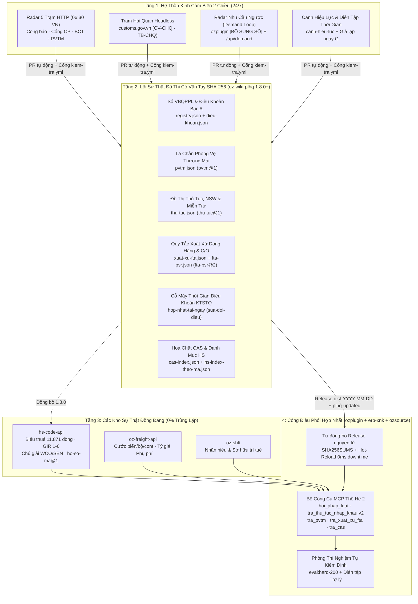
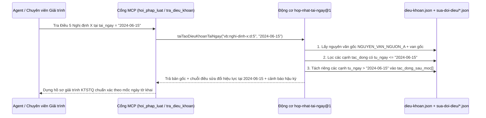

# Bản Thiết Kế Tổng Thể & Lộ Trình R&D Thế Hệ 2: Động Cơ Sự Thật Tuân Thủ XNK Việt Nam (`Wave 36 → Wave 41`)

> [!IMPORTANT]
> **Tuyên ngôn Kiến trúc Thế hệ 2:** Nếu Thế hệ 1 (`Wave 1 → 35`) đã biến [oz-wiki-plhq](TAM-NHIN-VA-KE-HOACH-HE-SINH-THAI.md) từ con số 0 thành **Thư viện Pháp luật Hải quan bậc A tự cập nhật**, thì Thế hệ 2 (`Wave 36 → 41`) nâng cấp toàn bộ hệ sinh thái lên **Động cơ Sự thật Tuân thủ Thông quan & Kiểm tra sau thông quan (Trade Compliance & Post-Clearance Truth Engine)** — nơi mọi câu hỏi sống còn về *Giấy phép KTCN, Miễn trừ, Thuế Phòng vệ thương mại, Quy tắc xuất xứ C/O cấp dòng hàng, Hoá chất CAS và Lịch sử điều khoản lùi 5 năm* đều được trả lời bằng **dữ liệu nguyên văn có vân tay SHA-256, 0% bịa luật**.

---

## 1. Chẩn đoán thực chứng tại vạch xuất phát (26/11/2026)

Trước khi đặt bút thiết kế, dưới đây là số liệu kiểm toán thực tế vừa đo trực tiếp trên nhánh `main` của [oz-wiki-plhq](../bao-cao/diem-mu.md) (`9ee7f01`) và [ozplugin](https://github.com/ozvietnam/ozplugin/blob/main/apps/gateway/src/main.ts) (`e40f1dd`):

| Chỉ số nền tảng hiện có | Con số thực đo | Điểm nghẽn / Mỏ vàng chưa khai mở |
| :--- | :--- | :--- |
| **Quy mô sổ đăng ký (`registry/van-ban/`)** | **3.280** văn bản (`1.592` đang hiệu lực, `470` tệp `.dieu.jsonl`, `654` trang wiki) | Còn **17** VB chưa tick đối chiếu bậc A, **23** VB thuộc Bộ/Tổng cục cũ sáp nhập, **8** VB hết hạn đêm `31/12/2026` |
| **Phòng vệ thương mại (`QĐ-BCT` CBPG/Tự vệ)** | **46** văn bản (`23` đang hiệu lực; **21/23** đã bóc `.dieu.jsonl`) | **`0/23` văn bản có bảng `danh_muc_hs`!** Kho đã có toàn văn nhưng chỉ mục mã HS đang mù 100% trước 23 lệnh áp thuế CBPG |
| **Kiểm tra chuyên ngành & Giấy phép** | **188** VB đang hiệu lực (`160` có `.dieu.jsonl`, `45` bảng `danh-muc/*.csv`) | Mới nối *Mã HS → Tên Thông tư*, chưa cấu trúc hoá *Mã thủ tục NSW, Hồ sơ gốc, Thời hạn SLA, Điều khoản miễn trừ* |
| **Hoá chất (`dist/cas-index.json`) & Chính sách HS** | **1.258** mã CAS + **5.597** nhóm HS trong `dist/` | Bên [tra-thu-tuc-nhap-khau.ts](https://github.com/ozvietnam/ozplugin/blob/main/apps/gateway/src/tools/tra-thu-tuc-nhap-khau.ts#L10-L29) của `ozplugin` vẫn chưa nối sang `KhoPlhq` (vẫn báo *"chưa có CSDL CAS ở Cổng"*) |
| **Xuất xứ FTA (`dist/xuat-xu-fta.json`)** | **19** FTA + **9** VB khung (`48` VB bậc A, `fta-psr@1`) | Mới ở cấp Hiệp định; thiếu `VIFTA` (#20), bảng **PSR cấp nhóm/phân nhóm HS** và đồ thị lỗi bác C/O thực chiến |
| **Đồ thị sửa đổi cấp Điều (`data/sua-doi-dieu/`)** | **88** tệp (`1.662` tác động trên `797` điều khoản) | Đã ghi lịch sử tác động nhưng chưa có hàm **tái dựng trạng thái điều khoản tại mốc `tai_ngay` quá khứ** phục vụ KTSTQ 5 năm |
| **Bộ đo chất lượng (`eval:*`)** | `retrieval`: **60/60 (100%)** · `holdout`: **46/48 (95,8%)** · `qa`: **58/60 (96,7%)** | `eval:retrieval` đã kịch trần 100% (hết độ phân giải dẫn đường R&D); `holdout` còn trượt đúng 2 ca (`HO-15`, `HO-40`) |

---

## 2. Kiến trúc Đích Thế Hệ 2 & 5 Bất biến Thiết kế



### 5 Bất biến Kiến trúc (Không bao giờ phá vỡ qua mọi làn sóng)
1. **Kho giữ sự thật nguyên văn — LLM giữ suy luận:** Không nhét prompt ẩn, điểm trọng số mập mờ hay văn xuôi suy diễn của AI vào các tệp `LUAT` trong `dist/`. Mọi con số, điều kiện miễn trừ, biên độ thuế CBPG hay tiêu chí PSR đều phải trỏ về `id` điều khoản `vb:<slug>:d:<dieu>` + `sha256_pdf` + vân tay `van`.
2. **Ranh giới sắt với `hs-code-api`:** `oz-wiki-plhq` không bao giờ phân loại hàng theo mô tả, không chứa chú giải HS/WCO/SEN, không tính thuế MFN/VAT. Hai kho gặp nhau duy nhất qua khoá nút biểu thuế `bieu:<ma_4_6_8_so>` và `khoa(so_hieu)`.
3. **Mọi truy vấn đều có chiều thời gian (`tai_ngay`):** Pháp luật XNK không phẳng — tờ khai mở ngày nào áp luật ngày đó. Mọi lược đồ mới (`pvtm@1`, `thu-tuc@1`, `fta-psr@2`, `hop-nhat-tai-ngay@1`) bắt buộc mang cặp `[hieu_luc_tu, het_hieu_luc_tu]` tường minh.
4. **Cổng kiểm tất định 100% trước khi chạm `main`:** Mọi dữ liệu tự động hay do bầy ong sinh ra đều phải qua kiểm tra đối chiếu nguyên văn PDF (`poppler-utils` ghim phiên bản), kiểm vân tay `manifest.json` và bộ đo không tụt lùi.
5. **Phát hành bất biến & nạp nóng không downtime:** Mọi thay đổi dữ liệu đóng gói vào GitHub Release `dist-YYYY-MM-DD` kèm `SHA256SUMS`; Cổng `ozplugin` tự tải, kiểm băm, tráo thư mục nguyên tử và nạp nóng trên RAM.

---

## 3. Lộ Trình Chi Tiết 6 Làn Sóng R&D (`Wave 36 → Wave 41`)

### Wave 36 — Khoá Sổ Bàn Cờ Hiện Tại, Diễn Tập `01/01/2027` & Vòng Phản Hồi Nhu Cầu Ngược
**Mục tiêu:** Đưa các bộ đo hiện hữu lên tuyệt đối (`holdout 48/48`, `qa 60/60`), diễn tập an toàn cuộc đại chuyển giao hiệu lực đêm `31/12/2026`, và khép vòng *"Khách hỏi hụt → Kho tự nạp"*.

- **Hạng mục kỹ thuật:**
  1. **Nâng `eval:holdout` từ `46/48 → 48/48 (100%)` và `eval:qa` từ `58/60 → 60/60 (100% DAT_NGUON_A)`:**
     - Sửa ca `HO-15` (`bay_van_ban_cu` đang đẩy `39/2015/TT-BTC` lên top 1 khi hỏi trị giá hải quan có sửa đổi tại `60/2019/TT-BTC`) và ca `HO-40` (`ngoai_pham_vi_oos` câu bảo hộ lao động nội địa chạm nhầm `ppe-nhap-khau` với độ tin cậy `CAO`).
     - Bổ sung nguồn bậc A cho 2 câu `MOT_PHAN` của `eval:qa` và sửa cảnh báo dẫn chiếu lịch sử `8378/QĐ-BCA` tại [55-2024-qh15.md](../wiki/sources/55-2024-qh15.md).
  2. **Quét dứt điểm đuôi điểm mù văn bản QPPL:**
     - Đối chiếu bậc A cho **17 văn bản** chưa chốt hiệu lực và rà soát kế thừa pháp lý cho **23 văn bản** thuộc Bộ/Tổng cục cũ sau sáp nhập (`BNNPTNT → BNNMT`, `BTTTT → BKHCN`, `TCHQ → CHQ`) trong [diem-mu.md](../bao-cao/diem-mu.md).
  3. **Công cụ Diễn tập Chuyển giao Năm mới (`tools/dien-tap-ngay-g.mjs`):**
     - Tạo bản chụp tạm trong thư mục nháp, chạy thật `chuyen-hieu-luc.mjs --ngay 2027-01-01` (8 văn bản hết hạn `31/12/2026` + 4 văn bản có hiệu lực `01/01/2027`), dựng `dist/` giả lập ngày `2027-01-01` và chạy toàn bộ `eval:retrieval` + `eval:qa` để bắt trước 35 ngày mọi trang wiki bị gãy tham chiếu.
  4. **Nối vòng phản hồi nhu cầu khách hàng (`ozplugin` `#571/#574/#575` ↔ `oz-wiki-plhq`) & Trạm Hải quan Headless:**
     - Rebase & hoàn thiện cụm PR Tầng 2 bên `ozplugin` (`tim_van_ban` trên `.gov.vn` + tự sinh thẻ `[BỔ SUNG SỔ]` nhãn `nhu-cau`).
     - Mở rộng [nap-stub-radar.mjs](../tools/nap-stub-radar.mjs) đọc luôn các Issue nhãn `nhu-cau`, đồng thời thêm workflow Playwright nhẹ chạy định kỳ cho `customs.gov.vn` để bóc `CV-CHQ` & `TB-CHQ` vượt vỏ SPA.

---

### Wave 37 — Lá Chắn Phòng Vệ Thương Mại (`pvtm@1`) — Khai Mở Ngay 23 Quyết Định Đang Nằm Chờ
**Mục tiêu:** Giải quyết ngay "điểm mù triệu đô" vừa phát hiện: biến **23 quyết định PVTM đang hiệu lực** (thép HRC, thép mạ, thép không gỉ, nhôm định hình, ván sợi gỗ, bàn ghế, gạch ốp lát, kính nổi, sợi polyester, đường, cáp thép, tháp điện gió...) thành dữ liệu cấu trúc tra cứu tức thì theo mã HS + nước xuất xứ + ngày tờ khai.

- **Lược đồ `registry/phong-ve-thuong-mai.yaml` → `dist/pvtm.json` (`chuan_pvtm: "pvtm@1"`, `lop_du_lieu: "LUAT"`):**
  ```yaml
  chuan_pvtm: pvtm@1
  vu_viec:
    - ma_vu_viec: AD17 # Rà soát ván sợi gỗ / ghế / thép...
      loai_bien_phap: CHONG_BAN_PHA_GIA # CHONG_BAN_PHA_GIA | CHONG_TRO_CAP | TU_VE | CHONG_LAN_TRANH
      ten_mat_hang: Một số sản phẩm ...
      trang_thai: DANG_AP_DUNG # DANG_DIEU_TRA | TAM_THOI | DANG_AP_DUNG | HET_HIEU_LUC
      xuat_xu_bi_ap: [CN, TH, ID, MY, TW, KR, IN] # Mã ISO-2 nước/vùng lãnh thổ xuất xứ
      ma_hs: ["44111200", "44111300", "44111400"] # Đối chiếu khớp nut_bieu bieu:<ma_8_so>
      dai_thue_suat_phan_tram:
        toi_thieu: 3.22
        toi_da: 37.13
        ghi_chu_nha_san_xuat: Theo Phụ lục Thông báo kèm QĐ rà soát hiện hành; cần C/O + Giấy chứng nhận nhà sản xuất (Manufacturer Certificate)
      chuoi_quyet_dinh:
        - so_hieu: 2927/QĐ-BCT
          vai_tro: RA_SOAT_HANG_NAM # KHOI_XUONG | TAM_THOI | CHINH_THUC | RA_SOAT_HANG_NAM | RA_SOAT_CUOI_KY | MIEN_TRU
          hieu_luc_tu: "2026-11-19"
          het_hieu_luc_tu: null
          dieu_dan_chieu: "vb:2927-qd-bct-2026:d:1"
      mien_tru_co_ban: true # Có cơ chế xin miễn trừ PVTM theo TT 26/2026/TT-BCT / NĐ 86/2025/NĐ-CP hay không
  ```
- **Tích hợp dọc toàn chuỗi:**
  - Trích đồng thời 23 bảng mã HS của các `QĐ-BCT` PVTM vào `danh-muc/` để `dist/hs-index-theo-ma.json` sáng đèn ngay lập tức.
  - Bổ sung kiểm tra chéo trong `kiem-tra.mjs`: mọi `so_hieu` trong `chuoi_quyet_dinh` phải tồn tại trong `registry/van-ban/`, mọi `ma_hs` phải có `nut_bieu` hợp lệ, văn bản hết hạn không được đứng làm căn cứ chính của vụ việc `DANG_AP_DUNG`.
  - Mở trường `phong_ve_thuong_mai[]` trong `plhq_chinh_sach_theo_hs` và nâng cấp `tra_thue` / `tra_thu_tuc_nhap_khau` bên `ozplugin` để cảnh báo đỏ khi cặp `(maHs, nuocXuatXu)` chạm vùng thuế CBPG!

---

### Wave 38 — Đồ Thị Thủ Tục Chuyên Ngành, Mã Một Cửa Quốc Gia & Điều Khoản Miễn Trừ (`thu-tuc@1`)
**Mục tiêu:** Đưa câu trả lời thủ tục nhập khẩu từ mức *"liệt kê tên Thông tư"* lên mức **"Bảng chỉ dẫn thông quan thực chiến trích nguyên văn nguồn A"**, đồng thời nối `cas-index.json` + `hs-index-theo-ma.json` vào thẳng `tra_thu_tuc_nhap_khau` trên `ozplugin` (đóng dứt điểm lỗ hổng `OZV-1582`).

- **Lược đồ `registry/thu-tuc-chuyen-nganh.yaml` → `dist/thu-tuc.json` (`chuan_thu_tuc: "thu-tuc@1"`, `lop_du_lieu: "LUAT"`):**
  - Mỗi thủ tục chuẩn hoá 7 thuộc tính sự thật pháp lý (không suy diễn):
    1. `ma_thu_tuc`: định danh chuẩn (`tt:byt-cong-bo-my-pham`, `tt:bnnmt-kiem-dich-thuc-vat`, `tt:bkhcn-ktcl-nhom-2`, `tt:bct-khai-bao-hoa-chat`...).
    2. `bo_quan_ly` & `co_quan_thuc_hien` + `cong_nsw` (mã/tên thủ tục trên Cổng thông tin Một cửa Quốc gia `vnsw.gov.vn` nếu văn bản quy định).
    3. `thoi_diem_kiem_tra`: `TRUOC_THONG_QUAN` | `SAU_THONG_QUAN` | `DANG_KY_TRUOC_MANG_HANG_BAO_QUAN`.
    4. `ho_so_bat_buoc[]`: danh sách ID điều khoản `vb:<slug>:d:<dieu>[:k:<khoan>]` quy định thành phần hồ sơ (kèm vân tay `van`).
    5. `thoi_han_giai_quyet`: chuỗi nguyên văn luật định + số ngày làm việc (ví dụ `3 ngày làm việc kể từ ngày nhận đủ hồ sơ hợp lệ`) + dẫn chiếu điều khoản.
    6. `truong_hop_mien_giam[]`: liên kết trực tiếp tới các điều khoản miễn kiểm tra (hàng mẫu, hành lý, quà biếu trong định mức, tạm nhập tái xuất, kho ngoại quan, hàng nhập gia công/SXXK theo `NĐ 15/2018/NĐ-CP`, `NĐ 74/2018/NĐ-CP`, `NĐ 85/2019/NĐ-CP`, `372/2026/NĐ-CP`...).
    7. `danh_muc_ap_dung[]`: nối 2 chiều sang các tệp `danh-muc/*.csv` hiện có.
- **Hợp nhất tại Cổng `ozplugin` (`tra_thu_tuc_nhap_khau` v2):**
  - Khi khách truyền `maHs` (và tùy chọn `cas[]`, `loaiHinh` như `E31`/`A11`/`H11`, `taiNgay`): công cụ kết hợp đồng thời `hs-code-api` + `KhoPlhq` (`hs-index-theo-ma`, `thu-tuc`, `pvtm`, `cas-index`) để trả về bức tranh 360 độ trong 1 lượt gọi duy nhất!

---

### Wave 39 — Chiều Sâu Xuất Xứ & C/O Ưu Đãi Cấp Dòng Hàng (`fta-psr@2`)
**Mục tiêu:** Nâng nền tảng `fta-psr@1` (Đợt 35) lên cấp độ dòng hàng & thẩm định chứng từ C/O — giải quyết điểm đau thực tế nhất của hàng nhập Trung Quốc (`Form E` ACFTA, `RCEP`) và hàng xuất khẩu sản xuất tại Việt Nam (`EVFTA`, `CPTPP`, `ATIGA`, `UKVFTA`, `VKFTA`, `VJEPA`, `VIFTA`).

- **3 trụ cột của `fta-psr@2`:**
  1. **Đủ 20/20 FTA Việt Nam:** Nạp chính thức các văn bản nguồn bậc A của **VIFTA (Việt Nam – Israel)** vào sổ đăng ký và `registry/xuat-xu-fta.yaml`.
  2. **Bảng Quy tắc cụ thể mặt hàng (`danh-muc/psr/<ma_fta>.csv` → `dist/fta-psr-theo-ma.json`):**
     - Bóc tách nguyên văn Phụ lục PSR của 7 FTA kim ngạch lớn nhất (`ACFTA`, `ATIGA`, `RCEP`, `EVFTA`, `CPTPP`, `VKFTA`, `VJEPA`) gắn vào `nut_bieu: "bieu:<ma_2_4_6_so>"`:
     - Cấu trúc hoá tiêu chí: `WO` (thuần tuý), `PE` (sản xuất hoàn toàn từ nguyên liệu có xuất xứ), `RVC(40)` (hàm lượng giá trị khu vực), `CTH` / `CTSH` / `CC` (chuyển đổi mã số hàng hoá cấp 2/4/6 số), `SP` (công đoạn gia công cụ thể), cùng `phien_ban_hs` (`HS_2017` / `HS_2022`).
  3. **Bản đồ Điều khoản Nghiệp vụ Thẩm định & Chống Bác C/O (`quy_tac_chung_tu_co`):**
     - Liên kết chính xác đến từng Điều/Khoản nguồn bậc A (`33/2023/TT-BTC`, `124/2026/TT-BTC`, các TT-BCT từng FTA) cho **8 tình huống bác C/O phổ biến nhất**:
       - Hoá đơn bên thứ ba (*Third-Party Invoicing* — ô số 7 / ô số 13 Form E, Form D);
       - Vận chuyển trực tiếp & Chứng từ không thay đổi xuất xứ khi quá cảnh Hongkong/Singapore (*Direct Consignment / Non-Manipulation Certificate*);
       - C/O giáp lưng (*Back-to-Back C/O*);
       - Cấp sau (*Issued Retroactively*) & bản sao chứng thực;
       - Sai khác nhỏ không làm mất hiệu lực C/O (*Minor Discrepancies*) & khác biệt mã HS giữa C/O và tờ khai nhập khẩu;
       - Ngưỡng linh hoạt *De Minimis* và Cộng gộp xuất xứ (*Cumulation*);
       - Tự chứng nhận xuất xứ (*REX* EVFTA, Nhà xuất khẩu đủ điều kiện RCEP/ATIGA, CPTPP);
       - Thời hạn nộp bổ sung C/O để hoàn thuế ưu đãi đặc biệt.

---

### Wave 40 — Cỗ Máy Thời Gian Điều Khoản Phục Vụ Kiểm Tra Sau Thông Quan (`hop-nhat-tai-ngay@1`)
**Mục tiêu:** Trong vòng **5 năm kể từ ngày đăng ký tờ khai** (Điều 78 Luật Hải quan `54/2014/QH13`), Hải quan có quyền Kiểm tra sau thông quan (KTSTQ). Khi giải trình một tờ khai mở ngày `15/06/2023` hoặc `10/08/2025`, doanh nghiệp phải trích đúng **lời văn của Điều X khoản Y đang có hiệu lực tại đúng ngày đó**, không phải bản đã sửa đổi năm 2026.



- **Hạng mục kỹ thuật:**
  1. Mở rộng phủ `data/sua-doi-dieu/*.json` từ **88 tệp lên 100% văn bản sửa đổi cấp Điều** có trong sổ; mỗi bản ghi `tac_dong` gắn thêm `id_dieu_nguon` (`vb:<slug_nguon>:d:<dieu>[:k:<khoan>]`) để nhảy thẳng sang nguyên văn lời sửa đổi trong `dieu-khoan.json`!
  2. Xây hàm tất định `taiTaoDieuKhoanTaiNgay(idDieu, taiNgay)` trong `oz-wiki-plhq` và đồng bộ sang adapter `ozplugin`:
     - Trả về: *(a)* văn bản gốc của điều khoản + tình trạng văn bản gốc tại `taiNgay`; *(b)* danh sách theo thứ tự thời gian các điều khoản sửa đổi/bổ sung/bãi bỏ **đã có hiệu lực tính đến `taiNgay`** (kèm nguyên văn `noi_dung` + `van` của điều sửa đổi); *(c)* danh sách các sửa đổi **chưa phát sinh hiệu lực tại `taiNgay`** (`tac_dong_sau_ngay_tra_cuu[]`) để LLM tuyệt đối không áp nhầm luật mới hồi tố cho tờ khai cũ!
  3. Nối trực tiếp vào công cụ `soan_ho_so_giai_trinh` bên `ozplugin` để chuyên viên Oz và khách hàng có vũ khí giải trình KTSTQ độc nhất thị trường.

---

### Wave 41 — Phòng Thí Nghiệm Tự Kiểm Định Khắc Nghiệt (`eval:hard-200`) & Cầu Nối Trực Tiếp `erp-xnk` / `ozsource`
**Mục tiêu:** Khi bài thi dễ (`60/60`), hệ thống ngừng thông minh hơn. Làn sóng 41 thiết lập một **"Đấu trường pháp lý thực chiến 200 ca bẫy (`eval:hard-200`)"** làm kim chỉ nam R&D dài hạn, đồng thời đưa kho tri thức cắm thẳng vào quy trình vận hành nội bộ của Oz (`erp-xnk` và `ozsource`).

- **Thiết kế bộ đề `eval/cau-hoi-kho-200.yaml` (`eval:hard-200`):**
  - Chia đều **8 nhóm bẫy nghiệp vụ thực tế** (25 ca/nhóm):
    1. **Bẫy KTSTQ lùi thời gian (`tai_ngay` 2021–2025):** điều khoản đã bị sửa 1–2 lần sau ngày mở tờ khai.
    2. **Bẫy hiệu lực tương lai & chuyển tiếp (`31/12/2026 → 01/01/2027`):** điều khoản chuyển tiếp cho hợp đồng/vận đơn ký trước ngày hiệu lực.
    3. **Bẫy Phòng vệ thương mại & Chống lẩn tránh:** hàng cùng mã HS nhưng khác nước xuất xứ hoặc thiếu chứng nhận nhà sản xuất.
    4. **Bẫy Miễn trừ KTCN đa điều kiện:** hàng mẫu, phi mậu dịch, tạm nhập tái xuất, gia công xuất khẩu — trường hợp nào được miễn KTCL nhưng **không** được miễn kiểm dịch/an toàn thực phẩm?
    5. **Bẫy C/O Form E / Form D / EUR.1 / CPTPP:** hoá đơn bên thứ 3, quá cảnh Hongkong không mở cont, sai lệch mã HS 6 số/8 số.
    6. **Bẫy Hoá chất kép (Mã HS thường nhưng chứa tiền chất CAS ngưỡng < 1% / ≥ 1%/5%).**
    7. **Bẫy Bộ/Tổng cục sáp nhập & Văn bản hợp nhất (`VBHN`):** phân biệt giá trị tham chiếu của `VBHN` với hiệu lực pháp lý của Thông tư gốc + Thông tư sửa đổi.
    8. **Bẫy Ranh giới Kho (`OOS` & Chuyển hướng `hs-code-api`):** câu hỏi gài phân loại GIR, tính tiền thuế, tranh chấp hợp đồng dân sự/lao động ngoài phạm vi hải quan.
- **Đưa vào vận hành nội bộ Oz (`erp-xnk` & `ozsource`):**
  - **`ozsource` (Extension đặt hàng 1688/Taobao):** khi khách/sale soi nguồn hàng trên sàn TQ, gọi nhẹ qua Cổng để hiện ngay huy hiệu cảnh báo sớm: *"Mặt hàng thuộc nhóm có nguy cơ dính KTCN / Giấy phép / Thuế CBPG từ TQ"* trước khi xuống tiền đặt cọc!
  - **`erp-xnk` (Gitea nội bộ, nhánh `develop`):** tích hợp checklist chứng từ thông quan tự động từ `thu-tuc@1` + `pvtm@1` + `fta-psr@2` vào hồ sơ lô hàng uỷ thác để nhân viên chứng từ không bao giờ sót C/O, công bố hay giấy phép chuyên ngành.

---

## 4. Ma Trận Thực Thi Bầy Ong & Cổng Đo Lường Qua Từng Chặng

> [!TIP]
> **Nguyên tắc chia việc cho Bầy ong (`Disjoint Ownership`):** Mọi làn sóng đều được thiết kế tách rời lớp dữ liệu (`registry/*.yaml`, `danh-muc/*.csv`), lớp công cụ dựng (`tools/lib/*.mjs`), lớp đánh giá (`eval/*`) và lớp tiêu thụ (`ozplugin` / `hs-code-api`) để 3–5 ong thợ luôn chạy song song trên các worktree riêng mà không bao giờ đụng tệp nhau.

| Làn sóng | Sản phẩm bàn giao cốt lõi | Thước đo nghiệm thu cứng (Pass Gate) | Phụ thuộc |
| :--- | :--- | :--- | :--- |
| **Wave 36** | Sạch nợ điểm mù QPPL · Diễn tập `01/01/2027` · Vòng lặp `nhu-cau` + Hải quan Headless | `eval:holdout` **48/48 (100%)** · `eval:qa` **60/60 `DAT_NGUON_A`** · Diễn tập `2027-01-01` **0 lỗi** | Khởi chạy ngay |
| **Wave 37** | `registry/phong-ve-thuong-mai.yaml` + 23 bảng HS PVTM + `dist/pvtm.json` (`pvtm@1`) + cảnh báo trên `ozplugin` | **23/23** QĐ PVTM hiệu lực có bảng mã HS & dải thuế khớp nguyên văn PDF · `kiem-tra` **0 lỗi** | Khởi chạy song song Wave 36 |
| **Wave 38** | `registry/thu-tuc-chuyen-nganh.yaml` + `dist/thu-tuc.json` (`thu-tuc@1`) + `tra_thu_tuc_nhap_khau` v2 (gộp CAS + PVTM) | Phủ **100% nhóm KTCN trọng điểm** của 6 Bộ (BCT, BYT, BNNMT, BKHCN, BXD, BCA) · Đóng `OZV-1582` | Sau nền `pvtm@1` |
| **Wave 39** | Bổ sung `VIFTA` (đủ **20/20 FTA**) + PSR 7 FTA lớn + Bản đồ 8 nhóm điều khoản bác C/O (`fta-psr@2`) | **20/20** FTA bậc A · PSR khớp `nut_bieu` · Mọi quy tắc C/O có `id` điều khoản + `van` SHA-256 | Độc lập, chạy song song Wave 38 |
| **Wave 40** | 100% đồ thị `sua-doi-dieu` gắn `id_dieu_nguon` + `taiTaoDieuKhoanTaiNgay` (`hop-nhat-tai-ngay@1`) | Tái tạo chính xác điều khoản tại mọi mốc `tai_ngay` lịch sử · Không lọt sửa đổi hậu kỳ | Sau khi ổn định `1.7.0/1.8.0` |
| **Wave 41** | Đề thi `eval:hard-200` chạy CI định kỳ + Cầu nối cảnh báo sớm `ozsource` & checklist lô hàng `erp-xnk` | Neo chuẩn đo lường mới **200 ca thực chiến** · 0% rò rỉ dữ liệu khách (`withPrivateData` giữ nguyên) | Hội tụ toàn chuỗi |

---

## 5. Ba Quyết Định Khởi Động Dành Cho CEO

1. **Thứ tự nổ phát súng đầu tiên:** Anh muốn cho bầy ong đánh song song cặp **Wave 36 (Khoá sổ `48/48` + Diễn tập `01/01/2027` + Vòng lặp nhu cầu)** + **Wave 37 (Lá chắn Phòng vệ thương mại `pvtm@1` cho 23 QĐ-BCT đang mù mã HS)** ngay trong đợt đầu chứ ạ?
2. **Phạm vi ưu tiên `fta-psr@2` (Wave 39):** Với bảng PSR cấp dòng hàng, ta ưu tiên bóc trước **Top 4 FTA sát sườn hàng nhập TQ/ASEAN & xuất khẩu chủ lực (`ACFTA` Form E, `RCEP`, `ATIGA` Form D, `EVFTA`)** rồi mở rộng sang `CPTPP`, `VKFTA`, `VJEPA`, `VIFTA` để ra thành quả thực chiến sớm nhất nhé anh?
3. **Độ mở của `ozplugin` trên Prod:** Bên `ozplugin` còn cụm 4 PR sẵn có (`#570`, `#571`, `#574`, `#575`) phục vụ tìm văn bản Tầng 2 & tự ghi thẻ `[BỔ SUNG SỔ]` — anh có muốn em rebase sạch cả cụm này vào phạm vi **Wave 36** để anh duyệt gộp một mẻ luôn không?
