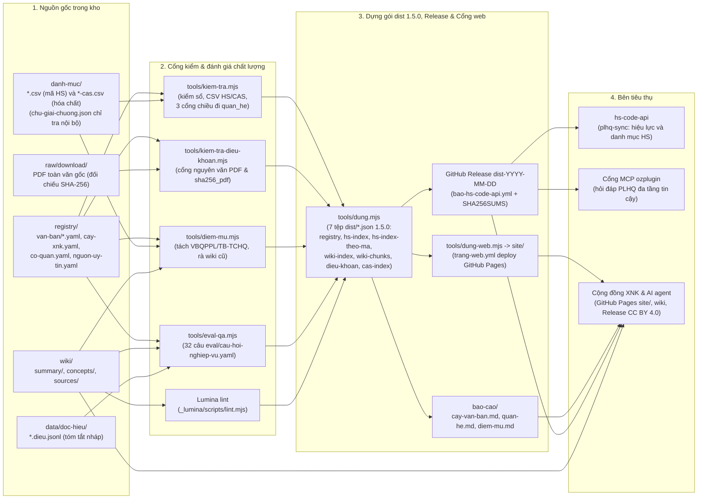
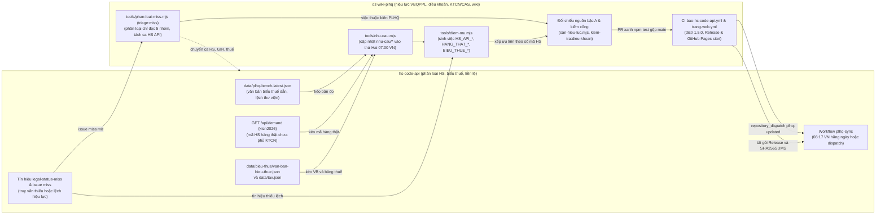

# Sơ đồ kiến trúc & ranh giới hệ thống (`oz-wiki-plhq`)

Tài liệu chuẩn hoá vai trò của **`oz-wiki-plhq`** trong hệ sinh thái tri thức hải quan – xuất nhập khẩu của OZ qua 4 giai đoạn nâng cấp (Wave 1–4), làm rõ ranh giới tuyệt đối **0% trùng lặp** với **`hs-code-api`** và **Cổng MCP (`ozplugin`)**, dòng chảy gói dữ liệu máy `1.5.0` (`7` tệp `dist/*.json`), cổng tra cứu web công khai (`site/` trên GitHub Pages), vòng lặp phản hồi hai chiều và bảng công cụ/sản phẩm.

---

## Phần 1 — Bảng ranh giới tuyệt đối: `oz-wiki-plhq` ↔ `hs-code-api` ↔ Cổng MCP (`ozplugin`)

Ba thành phần hợp tác theo nguyên tắc **một nguồn sự thật cho từng miền bài toán** — không sao chép chồng chéo, không suy luận thay miền của nhau:

| Miền tri thức / Năng lực | `oz-wiki-plhq` (Kho tri thức PLHQ mở) | `hs-code-api` (Động cơ phân loại HS & biểu thuế) | Cổng MCP `ozplugin` ("Cổng OZ") |
|---|---|---|---|
| **Hiệu lực VBQPPL & quan hệ cũ–mới** | **Nguồn gốc sự thật (`registry/van-ban/*.yaml`)**: 6 trạng thái hiệu lực, quan hệ chiều đi (`thay_the`, `sua_doi`, `bai_bo`, `tam_ngung`, `huong_dan`, `hop_nhat`) được kiểm tự động 3 cổng chiều đi trong `tools/kiem-tra.mjs` (chặn ngược thời gian, chặn `HIEN_PHAP`/`LUAT`/`NGHI_QUYET` dùng `huong_dan`, chỉ `VAN_BAN_HOP_NHAT` dùng `hop_nhat`), cạnh ngược tính sẵn trong `dist/registry.json`, đối chiếu nguồn bậc A (`congbao.chinhphu.vn`, `vanban.chinhphu.vn`, `vbpl.vn`, cổng bộ) | Tiêu thụ `dist/registry.json` qua `scripts/sync-plhq.mjs` (`plhq-sync`) để gắn `legalBasisRegistry` và cảnh báo `policyBasisReview` theo từng mã HS | Đọc nguyên giá trị `tinh_trang`, `het_hieu_luc_tu`, `xac_minh.hieu_luc_da_doi_chieu`, **không tự suy luận lại hiệu lực** |
| **Phân loại HS, 6 quy tắc GIR & Chú giải HS** | **KHÔNG phục vụ API phân loại HS.** Riêng `danh-muc/chu-giai-chuong.json` (trích tiếng Việt từ Công báo TT `31/2022/TT-BTC` bằng `tools/trich-chu-giai.mjs`) **chỉ dùng tra cục bộ khi soạn wiki** (`node tools/chu-giai.mjs`), **tuyệt đối không xuất ra `dist/` hay `site/`** | **Nguồn sự thật & động cơ phân loại**: 6 quy tắc tổng quát GIR (`lib/gir.js`), chú giải WCO EN, AHTN SEN (`ahtn_sen`), chú giải chương/nhóm 4 số, `/api/suggest`, `/api/classify`, `/api/describe` | Gọi `hs-code-api` cho mọi bài toán xác định mã HS, giải thích GIR và chú giải HS |
| **Biểu thuế XNK & thuế suất** | **KHÔNG lưu thuế suất.** Chỉ giữ bản chụp rút gọn mã 8 số + mô tả dòng trong `nhu-cau/bieu-thue.json` (chụp từ `data/tax.json`) để kiểm tồn tại mã CSV (`HS_KHONG_TON_TAI`) và sinh cảnh báo `canh_bao_ma` | **Nguồn sự thật biểu thuế (`data/tax.json`)**: thuế suất NK/ƯĐ/FTA/GTGT/TTĐB, tính thuế theo ngày đăng ký (`/api/tax`) | Gọi `hs-code-api` (`/api/tax`) để tra thuế suất và điều kiện hưởng ưu đãi thuế |
| **Tiền lệ phân loại (TB-TCHQ, quốc tế, MiC)** | **Chỉ crawl thô & đóng gói lô kiểm chứng** ở đầu nguồn (`Luồng 11`: `data/customs/`, `tools/dong-goi-lo-tb-tchq.mjs`; `Luồng 12`: quốc tế & MiC). Chỉ xuất mật độ tham khảo bậc C vào `hs-index-theo-ma.json`; báo cáo điểm mù tách riêng tầng TB-TCHQ (`TB_TCHQ_KHONG_NGUON_A`, `TB_TCHQ_CHUA_DOI_CHIEU`) | **Kho hợp nhất & phục vụ tra cứu**: giữ `data/precedents.json` (gộp qua `merge-community.mjs`), kiểm `validate-community.mjs`, phục vụ `/api/precedents` và tra cứu tiền lệ | Gọi `hs-code-api` (`/api/precedents`) khi người dùng cần tiền lệ phân loại |
| **Điều khoản pháp lý có cấu trúc** | **Nguồn sự thật phân tách 2 tầng (`dist/dieu-khoan.json`)**: tầng `NGUYEN_VAN_NGUON_A` từ `xac_minh.dieu_khoan` (được cổng `npm run kiem-tra:dieu-khoan` đối chiếu nguyên văn với PDF/`trang_pdf` và băm `sha256_pdf` trước khi xuất) và tầng `TOM_TAT_NHAP` từ `data/doc-hieu/*.dieu.jsonl` (`da_soat: false`, chỉ dùng định vị điều luật) | Tiêu thụ điều khoản nguyên văn bậc A (vd `85/2026/TT-BTC`) để kiểm thử so khớp `lib/legal-basis.js` và trả `canCuPhapLy[]` | Đọc `dist/dieu-khoan.json`; **chỉ trích nguyên văn tầng `NGUYEN_VAN_NGUON_A`**, gắn nhãn cảnh báo khi dùng `TOM_TAT_NHAP` |
| **Wiki nghiệp vụ PLHQ & tìm kiếm theo đoạn** | **Nguồn sự thật (`wiki/summary/`, `wiki/concepts/`, `wiki/sources/`)**: tổng hợp nghiệp vụ XNK có dẫn nguồn, rà trang lỗi thời bằng `WIKI_DAN_VB_HET_HIEU_LUC`, đóng gói thành `dist/wiki-index.json` và `dist/wiki-chunks.json` kèm cờ `canh_bao_hieu_luc` | Không lưu trữ hay chia đoạn wiki nghiệp vụ | Đọc `dist/wiki-index.json` & `dist/wiki-chunks.json` cho hỏi đáp PLHQ; kiểm `canh_bao_hieu_luc` và `van_ban_lien_quan[]` trước khi trả lời |
| **Bảng phụ lục mã HS & hóa chất mã CAS** | **Nguồn sự thật (`danh-muc/*.csv` & `danh-muc/*-cas.csv`)**: trích nguyên văn phụ lục KTCN, cấm, giấy phép, phòng vệ thương mại (`dist/hs-index.json`, `dist/hs-index-theo-ma.json`) và bảng CAS (`dist/cas-index.json`) | Tiêu thụ `dist/hs-index*.json` để gắn nghĩa vụ KTCN/giấy phép theo tiền tố mã HS 4/6/8 số trên `/api/tax` | Đọc `dist/hs-index-theo-ma.json` và `dist/cas-index.json` (tra hóa chất theo mã CAS, vd NĐ `24/2026/NĐ-CP`) |
| **Cổng tra cứu web công khai (`site/` — GitHub Pages)** | **Dựng cổng web tĩnh 0 CDN (`npm run dung:web` → `site/`)** qua `.github/workflows/trang-web.yml` với 4 thẻ: Hiệu lực văn bản, Wiki & Hỏi đáp, Điều khoản bậc A (tách rõ 2 tầng), Hóa chất CAS (`24/2026/NĐ-CP`). **Không phân loại HS hay tính thuế** | Vận hành API và giao diện tra mã HS, GIR, biểu thuế XNK và tiền lệ phân loại | Dẫn liên kết tới nguồn bậc A và cổng tra cứu PLHQ khi cần; không dùng cổng web để thay API HS/thuế |
| **Đánh giá QA & phân loại issue `[miss]`** | **Chấm phủ PLHQ (`npm run eval:qa`, 32 câu)** và **phân loại chỉ đọc (`npm run triage:miss`)** tách issue `[miss]` thành 5 nhóm (`DA_CO_TRONG_SO`, `THUOC_HS_CODE_API`, `THIEU_VAN_BAN_MOI`, `THIEU_WIKI_HOAC_DIEU_KHOAN`, `KHAC_CAN_RA_SOAT`) | Tiếp nhận các ca thuộc nhóm `THUOC_HS_CODE_API` (áp mã 8 số, biểu thuế, GIR, chú giải HS, tiền lệ) | Chuyển đúng tuyến câu hỏi khi phát hiện thiếu dữ liệu |
| **Tài liệu bản quyền WCO / AHTN SEN** | **Không nạp vào kho công khai.** Đánh dấu trong `xac_minh.nguon_rieng_tu` (vd trên `85/2026/TT-BTC`) để `tools/diem-mu.mjs` không báo thiếu giả | Mua bản quyền và xử lý riêng tư trong phạm vi nội bộ (`wco_compendium`, `ahtn_sen`) | Không trực tiếp lưu trữ bản gốc có bản quyền; nhận kết quả qua API được phép |
| **Ghi nguồn & miễn trừ trách nhiệm** | Xuất sẵn `giay_phep` (CC BY 4.0), `ghi_nguon_chuan`, `mien_tru` trong mọi tệp máy `dist/` `1.5.0` và chân trang `site/` | Trả trạng thái kèm căn cứ pháp lý và nguồn trích | **Luôn hiển thị** miễn trừ ("tham khảo, không phải tư vấn pháp lý"), link nguồn bậc A và chuỗi ghi nguồn CC BY 4.0 |

> **Quy tắc bất biến về `chu-giai-chuong.json`:** `danh-muc/chu-giai-chuong.json` là công cụ phụ trợ cục bộ giúp người/agent đối chiếu thuật ngữ khi soạn wiki (`node tools/chu-giai.mjs`). Mọi thay đổi ở `tools/dung.mjs` và `tools/dung-web.mjs` **tuyệt đối không** tạo `chu-giai-hs.json` hay sao chép `chu-giai-chuong.json` vào `dist/` hoặc `site/`.

---

## Phần 2 — Sơ đồ kiến trúc dòng chảy tri thức

Toàn bộ dữ liệu đi qua các cổng kiểm tự động (sổ, quan hệ chiều đi `quan_he`, nguyên văn điều khoản `kiem-tra:dieu-khoan`, điểm mù, `eval:qa` 32 câu, Lumina lint), dựng gói dữ liệu máy `1.5.0` (7 tệp `dist/*.json` + `SHA256SUMS`), phát hành GitHub Release bất biến và dựng cổng tra cứu web công khai `site/` trên GitHub Pages:

---

## Phần 3 — Sơ đồ vòng lặp phản hồi hai chiều

Hai kho tự động nuôi nhau theo chu kỳ: `hs-code-api` gửi tín hiệu sử dụng thực tế (`nhu-cau/*`, tín hiệu `legal-status-miss`) và các issue `[miss]` mở được công cụ chỉ đọc `phan-loai-miss` sàng lọc để giữ ranh giới 0% trùng lặp, còn `oz-wiki-plhq` đối chiếu nguồn bậc A, kiểm nguyên văn điều khoản và đẩy ngược bản chụp `dist-YYYY-MM-DD` cùng cổng web tĩnh `site/`:

---

## Phần 4 — Bảng công cụ, cổng kiểm & sản phẩm (Wave 1–4)

| Nhóm | Lệnh / Tệp nguồn | Sản phẩm / Đầu ra | Vai trò trong hệ thống |
|---|---|---|---|
| **Kiểm sổ & chiều đi `quan_he`** | `npm run kiem-tra` (`tools/kiem-tra.mjs`) | Báo cáo lỗi/cảnh báo (chặn PR nếu lỗi) | Kiểm lược đồ 2.800+ tệp YAML, CSV HS/CAS, nguồn bậc A và **3 cổng chiều đi `quan_he`** (Wave 2): chặn cạnh ngược thời gian, chặn `HIEN_PHAP`/`LUAT`/`NGHI_QUYET` dùng `huong_dan`, chỉ `VAN_BAN_HOP_NHAT` dùng `hop_nhat` |
| **Kiểm nguyên văn điều khoản** | `npm run kiem-tra:dieu-khoan` (`tools/kiem-tra-dieu-khoan.mjs`) | Kết quả đối chiếu từng mục `xac_minh.dieu_khoan` | Kiểm độ dài/chỉ số `dieu`, xác thực `sha256_pdf` thuần Node trên mọi môi trường và so khớp nguyên văn theo `trang_pdf` khi có `pdftotext` (an toàn trên CI Linux thiếu `pdftotext`, Wave 3) |
| **Phát hiện điểm mù** | `npm run diem-mu` (`tools/diem-mu.mjs` → `bao-cao/diem-mu.md`) | Báo cáo điểm mù tách tầng & xếp ưu tiên | Tách riêng VBQPPL vs TB-TCHQ cá biệt (`TB_TCHQ_KHONG_NGUON_A`, `TB_TCHQ_CHUA_DOI_CHIEU`), rà `WIKI_DAN_VB_HET_HIEU_LUC` và `WIKI_CHUA_CO_VB_NEN_TANG` (Wave 1) |
| **Đánh giá hỏi đáp PLHQ** | `npm run eval:qa` (`tools/eval-qa.mjs`) | Báo cáo Markdown / `--json` trên **32 câu** (`eval/cau-hoi-nghiep-vu.yaml`) | Đo độ phủ 3 tiêu chí: `(a)` sổ `CON_HIEU_LUC` + `NGUON_A`, `(b)` trang wiki hiện hành, `(c)` có điều khoản `NGUYEN_VAN_NGUON_A` hoặc `TOM_TAT_NHAP` (Wave 1 & 3) |
| **Phân loại issue `[miss]`** | `npm run triage:miss` (`tools/phan-loai-miss.mjs`) | Báo cáo Markdown / `--json` (chỉ đọc, không sửa GitHub) | Phân loại deterministic issue `[miss]` thành 5 nhóm: `DA_CO_TRONG_SO`, `THUOC_HS_CODE_API`, `THIEU_VAN_BAN_MOI`, `THIEU_WIKI_HOAC_DIEU_KHOAN`, `KHAC_CAN_RA_SOAT` (Wave 4) |
| **Dựng gói máy `1.5.0` & báo cáo** | `npm run dung` (`tools/dung.mjs`) | 7 tệp `dist/*.json` (`1.5.0`) + `bao-cao/cay-van-ban.md`, `bao-cao/quan-he.md` | Sinh `registry.json`, `hs-index.json`, `hs-index-theo-ma.json`, `wiki-index.json`, `wiki-chunks.json`, `dieu-khoan.json`, `cas-index.json` (Wave 1) |
| **Dựng cổng tra cứu web tĩnh** | `npm run dung:web` (`tools/dung-web.mjs`, `tools/web-template/*`) | Thư mục `site/` (`.nojekyll`, `index.html`, `app.js`, `style.css`, `data/*.json`) | Cổng tra cứu công khai 0 CDN gồm 4 thẻ: Hiệu lực văn bản, Wiki & Hỏi đáp, Điều khoản bậc A, Hóa chất CAS (`24/2026/NĐ-CP`) (Wave 4) |
| **Kiểm tra wiki Lumina** | `node _lumina/scripts/lint.mjs --summary` | Tóm tắt JSON (`L01..L22`) | Kiểm frontmatter, cấu trúc mục và liên kết hai chiều toàn bộ `wiki/` |
| **Workflow CI/CD** | `.github/workflows/kiem-tra.yml` `.github/workflows/bao-hs-code-api.yml` `.github/workflows/trang-web.yml` `.github/workflows/bao-cao-tuan.yml` | Kiểm PR, Release `dist-YYYY-MM-DD` + `SHA256SUMS`, GitHub Pages `site/`, báo cáo tuần | Tự động hóa toàn chuỗi kiểm thử (`npm test`), phát hành bản chụp `dist/` bất biến, đồng bộ `hs-code-api` và triển khai cổng web công khai |

---

## Phần 5 — Bản đồ lộ trình nâng cấp 4 Giai đoạn (Wave 1–4)

Lộ trình tập trung hoàn toàn vào **năng lực cốt lõi của `oz-wiki-plhq`** (hiệu lực VBQPPL, điều khoản nguyên văn, danh mục HS/CAS, wiki PLHQ, cổng kiểm, đánh giá hỏi đáp và cổng tra cứu web tĩnh) — **đã cắt sạch mọi hạng mục trùng với `hs-code-api`**:

| Giai đoạn | Mục tiêu trọng tâm | Hạng mục triển khai theo Wave 1–4 | Tiêu chí đạt |
|---|---|---|---|
| **Giai đoạn 1** Khóa ranh giới & chuẩn kiểm soát *(Wave 1 & 2)* | Tách rạch ròi vai trò với `hs-code-api`; làm sạch điểm mù giả, cạnh ngược và wiki lỗi thời | 1. Tài liệu hoá ranh giới & kiến trúc (`docs/SO-DO-HE-THONG.md`). 2. Tách tầng VBQPPL vs TB-TCHQ cá biệt trong `tools/diem-mu.mjs` (`TB_TCHQ_KHONG_NGUON_A`, `TB_TCHQ_CHUA_DOI_CHIEU`, miễn `CO_QUAN_DA_SAP_NHAP` cho TB-TCHQ); thêm `WIKI_DAN_VB_HET_HIEU_LUC` và `WIKI_CHUA_CO_VB_NEN_TANG`. 3. Dọn sạch cạnh `quan_he` ngược thời gian/sai vai trò và đặt 3 cổng kiểm tự động trong `tools/kiem-tra.mjs` (Wave 2). 4. Dọn 12 trang wiki `summary/` & `concepts/` hết `WIKI_DAN_VB_HET_HIEU_LUC`; thiết lập `eval/cau-hoi-nghiep-vu.yaml` (**32 câu**) + `tools/eval-qa.mjs`. | `npm test`, `npm run kiem-tra`, `node _lumina/scripts/lint.mjs --summary` đạt 0 lỗi, 0 cảnh báo; `WIKI_DAN_VB_HET_HIEU_LUC = 0` |
| **Giai đoạn 2** Xuất gói dữ liệu máy `1.5.0` & CI Release *(Wave 1)* | Cung cấp giao diện dữ liệu máy sạch, tách tầng tin cậy cho Cổng MCP (`ozplugin`) | 1. Nâng `LUOC_DO_PHIEN_BAN` lên `'1.5.0'` trong `tools/lib/registry.mjs`. 2. Dựng `tools/lib/wiki-dist.mjs` & `tools/lib/dieu-khoan-dist.mjs`, tích hợp vào `tools/dung.mjs` xuất đủ 7 tệp `dist/*.json` (`registry`, `hs-index`, `hs-index-theo-ma`, `wiki-index`, `wiki-chunks`, `dieu-khoan`, `cas-index`). 3. Cập nhật `.github/workflows/bao-hs-code-api.yml` kiểm hash, phát hành đủ 7 tệp `dist/*.json` + `SHA256SUMS` vào Release `dist-YYYY-MM-DD`. 4. Chuẩn hoá hợp đồng trường trong `docs/tich-hop.md` & `docs/luoc-do-so-dang-ky.md`. | Đủ 7 tệp `dist/*.json` mang `luoc_do_phien_ban: "1.5.0"`, không tồn tại `chu-giai-hs.json` hay `chu-giai-chuong.json` trong `dist/`, test tự động xanh |
| **Giai đoạn 3** Phủ sâu & kiểm nguyên văn điều khoản nguồn A *(Wave 3)* | Nâng tỷ trọng câu trả lời đạt căn cứ nguyên văn bậc A (`NGUYEN_VAN_NGUON_A`) và khóa kiểm nguyên văn | 1. Dựng cổng `tools/kiem-tra-dieu-khoan.mjs` (`npm run kiem-tra:dieu-khoan`) đối chiếu nguyên văn theo `trang_pdf` và băm `sha256_pdf` trên tệp toàn văn (an toàn khi CI thiếu `pdftotext`). 2. Trích nguyên văn `xac_minh.dieu_khoan` từ PDF bậc A cho các văn bản khung (`38/2015/TT-BTC`, `121/2025/TT-BTC`, `39/2015/TT-BTC`, `108/2025/QH15`, `11/2026/QH16`, `31/2026/QĐ-TTg`, `124/2026/TT-BTC`, `33/2025/TT-BCT`, `28/2026/TT-BCT`, `49/2026/TT-BXD` và chuẩn hoá `85/2026/TT-BTC`). 3. Bổ sung concept `thu-tuc-tai-cua-khau-nhap`, `thue-chong-ban-pha-gia-thep` và làm sạch dẫn chiếu cũ ở `wiki/sources/`. | `npm run kiem-tra:dieu-khoan` 0 lỗi; `eval:qa` đạt 100% tiêu chí `(b)` và tăng mạnh `DAT_NGUON_A` |
| **Giai đoạn 4** Cổng web xã hội, phân loại `[miss]` & vận hành khép kín *(Wave 4)* | Phục vụ cộng đồng XNK qua cổng web tĩnh, tự động hóa sàng lọc `[miss]` và vận hành MCP | 1. Dựng cổng tra cứu web tĩnh 0 CDN (`tools/dung-web.mjs`, `npm run dung:web` → `site/`) với 4 thẻ: Hiệu lực văn bản, Wiki & Hỏi đáp, Điều khoản bậc A, Hóa chất CAS (`24/2026/NĐ-CP`). 2. Triển khai GitHub Pages tự động qua `.github/workflows/trang-web.yml` (thư mục `site/` được gitignore). 3. Tạo công cụ chỉ đọc `tools/phan-loai-miss.mjs` (`npm run triage:miss`) phân loại issue `[miss]` thành 5 nhóm để giữ biên với `hs-code-api`. 4. Vận hành khép kín Cổng MCP `ozplugin` trên Release `1.5.0` và vòng phản hồi hằng tuần. | `site/` triển khai sạch lên GitHub Pages, `triage:miss` tách đúng biên `hs-code-api`, không trôi sang phân loại HS/thuế suất/tiền lệ |

### Các phần đã cắt bỏ khỏi lộ trình (thuộc ranh giới `hs-code-api`)

- **Không** xuất `chu-giai-chuong.json`, `chu-giai-hs.json`, WCO Explanatory Notes hay AHTN SEN ra `dist/` hoặc `site/`.
- **Không** dựng API, trang web hoặc bộ máy gợi ý / áp mã HS theo mô tả hàng hoá hay 6 quy tắc GIR.
- **Không** lưu trữ hoặc tính toán thuế suất biểu thuế XNK trong `oz-wiki-plhq`.
- **Không** tự phục vụ chỉ mục tiền lệ phân loại thay cho `/api/precedents` của `hs-code-api` (`oz-wiki-plhq` chỉ dừng ở crawl/đóng gói lô theo Luồng 11 và Luồng 12).
