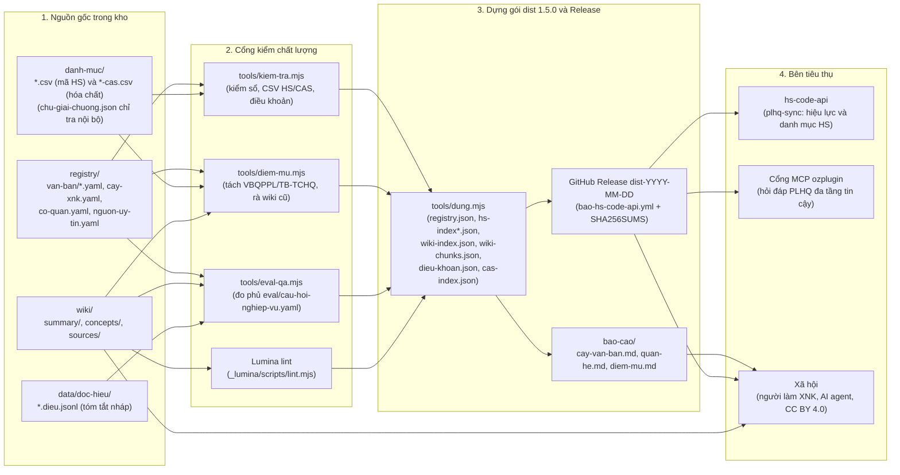
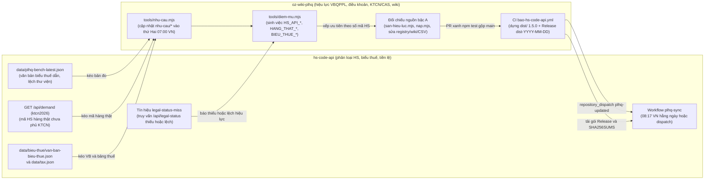

# Sơ đồ kiến trúc & ranh giới hệ thống (`oz-wiki-plhq`)

Tài liệu chuẩn hoá vai trò của **`oz-wiki-plhq`** trong hệ sinh thái tri thức hải quan – xuất nhập khẩu của OZ, làm rõ ranh giới tuyệt đối với **`hs-code-api`** và **Cổng MCP (`ozplugin`)**, dòng chảy dữ liệu gói máy `1.5.0`, vòng lặp phản hồi hai chiều và lộ trình nâng cấp 4 giai đoạn.

---

## Phần 1 — Bảng ranh giới tuyệt đối: `oz-wiki-plhq` ↔ `hs-code-api` ↔ Cổng MCP (`ozplugin`)

Ba thành phần hợp tác theo nguyên tắc **một nguồn sự thật cho từng miền bài toán** — không sao chép chồng chéo, không suy luận thay miền của nhau:

| Miền tri thức / Năng lực | `oz-wiki-plhq` (Kho tri thức PLHQ mở) | `hs-code-api` (Động cơ phân loại HS & biểu thuế) | Cổng MCP `ozplugin` ("Cổng OZ") |
|---|---|---|---|
| **Hiệu lực VBQPPL & quan hệ cũ–mới** | **Nguồn gốc sự thật (`registry/van-ban/*.yaml`)**: 6 trạng thái hiệu lực, quan hệ chiều đi (`thay_the`, `sua_doi`, `bai_bo`, `tam_ngung`, `huong_dan`, `hop_nhat`), cạnh ngược tính sẵn trong `dist/registry.json`, đối chiếu nguồn bậc A (`congbao.chinhphu.vn`, `vanban.chinhphu.vn`, `vbpl.vn`, cổng bộ) | Tiêu thụ `dist/registry.json` qua `scripts/sync-plhq.mjs` (`plhq-sync`) để gắn `legalBasisRegistry` và cảnh báo `policyBasisReview` theo từng mã HS | Đọc nguyên giá trị `tinh_trang`, `het_hieu_luc_tu`, `xac_minh.hieu_luc_da_doi_chieu`, **không tự suy luận lại hiệu lực** |
| **Phân loại HS, 6 quy tắc GIR & Chú giải HS** | **KHÔNG phục vụ API phân loại HS.** Riêng `danh-muc/chu-giai-chuong.json` (trích tiếng Việt từ Công báo TT `31/2022/TT-BTC` bằng `tools/trich-chu-giai.mjs`) **chỉ dùng tra cục bộ khi soạn wiki** (`node tools/chu-giai.mjs`), **tuyệt đối không xuất ra `dist/`** | **Nguồn sự thật & động cơ phân loại**: 6 quy tắc tổng quát GIR (`lib/gir.js`), chú giải WCO EN, AHTN SEN (`ahtn_sen`), chú giải chương/nhóm 4 số, `/api/suggest`, `/api/classify`, `/api/describe` | Gọi `hs-code-api` cho mọi bài toán xác định mã HS, giải thích GIR và chú giải HS |
| **Biểu thuế XNK & thuế suất** | **KHÔNG lưu thuế suất.** Chỉ giữ bản chụp rút gọn mã 8 số + mô tả dòng trong `nhu-cau/bieu-thue.json` (chụp từ `data/tax.json`) để kiểm tồn tại mã CSV (`HS_KHONG_TON_TAI`) và sinh cảnh báo `canh_bao_ma` | **Nguồn sự thật biểu thuế (`data/tax.json`)**: thuế suất NK/ƯĐ/FTA/GTGT/TTĐB, tính thuế theo ngày đăng ký (`/api/tax`) | Gọi `hs-code-api` (`/api/tax`) để tra thuế suất và điều kiện hưởng ưu đãi thuế |
| **Tiền lệ phân loại (TB-TCHQ, quốc tế, MiC)** | **Chỉ crawl thô & đóng gói lô kiểm chứng** ở đầu nguồn (`Luồng 11`: `data/customs/`, `tools/dong-goi-lo-tb-tchq.mjs`; `Luồng 12`: quốc tế & MiC). Chỉ xuất mật độ tham khảo bậc C vào `hs-index-theo-ma.json` | **Kho hợp nhất & phục vụ tra cứu**: giữ `data/precedents.json` (gộp qua `merge-community.mjs`), kiểm `validate-community.mjs`, phục vụ `/api/precedents` và tra cứu tiền lệ | Gọi `hs-code-api` (`/api/precedents`) khi người dùng cần tiền lệ phân loại |
| **Điều khoản pháp lý có cấu trúc** | **Nguồn sự thật phân tách 2 tầng (`dist/dieu-khoan.json`)**: tầng `NGUYEN_VAN_NGUON_A` từ `xac_minh.dieu_khoan` (được trích dẫn làm căn cứ) và tầng `TOM_TAT_NHAP` từ `data/doc-hieu/*.dieu.jsonl` (`da_soat: false`, chỉ dùng định vị điều luật) | Tiêu thụ điều khoản nguyên văn bậc A (vd `85/2026/TT-BTC`) để kiểm thử so khớp `lib/legal-basis.js` và trả `canCuPhapLy[]` | Đọc `dist/dieu-khoan.json`; **chỉ trích nguyên văn tầng `NGUYEN_VAN_NGUON_A`**, gắn nhãn cảnh báo khi dùng `TOM_TAT_NHAP` |
| **Wiki nghiệp vụ PLHQ & tìm kiếm theo đoạn** | **Nguồn sự thật (`wiki/summary/`, `wiki/concepts/`, `wiki/sources/`)**: tổng hợp nghiệp vụ XNK có dẫn nguồn, đóng gói thành `dist/wiki-index.json` và `dist/wiki-chunks.json` kèm cờ `canh_bao_hieu_luc` | Không lưu trữ hay chia đoạn wiki nghiệp vụ | Đọc `dist/wiki-index.json` & `dist/wiki-chunks.json` cho hỏi đáp PLHQ; kiểm `canh_bao_hieu_luc` và `van_ban_lien_quan[]` trước khi trả lời |
| **Bảng phụ lục mã HS & hóa chất mã CAS** | **Nguồn sự thật (`danh-muc/*.csv` & `danh-muc/*-cas.csv`)**: trích nguyên văn phụ lục KTCN, cấm, giấy phép, phòng vệ thương mại (`dist/hs-index.json`, `dist/hs-index-theo-ma.json`) và bảng CAS (`dist/cas-index.json`) | Tiêu thụ `dist/hs-index*.json` để gắn nghĩa vụ KTCN/giấy phép theo tiền tố mã HS 4/6/8 số trên `/api/tax` | Đọc `dist/hs-index-theo-ma.json` và `dist/cas-index.json` (tra hóa chất theo mã CAS, vd NĐ `24/2026/NĐ-CP`) |
| **Tài liệu bản quyền WCO / AHTN SEN** | **Không nạp vào kho công khai.** Đánh dấu trong `xac_minh.nguon_rieng_tu` (vd trên `85/2026/TT-BTC`) để `tools/diem-mu.mjs` không báo thiếu giả | Mua bản quyền và xử lý riêng tư trong phạm vi nội bộ (`wco_compendium`, `ahtn_sen`) | Không trực tiếp lưu trữ bản gốc có bản quyền; nhận kết quả qua API được phép |
| **Ghi nguồn & miễn trừ trách nhiệm** | Xuất sẵn `giay_phep` (CC BY 4.0), `ghi_nguon_chuan`, `mien_tru` trong mọi tệp máy `dist/` `1.5.0` | Trả trạng thái kèm căn cứ pháp lý và nguồn trích | **Luôn hiển thị** miễn trừ ("tham khảo, không phải tư vấn pháp lý"), link nguồn bậc A và chuỗi ghi nguồn CC BY 4.0 |

> **Quy tắc bất biến về `chu-giai-chuong.json`:** `danh-muc/chu-giai-chuong.json` là công cụ phụ trợ cục bộ giúp người/agent đối chiếu thuật ngữ khi soạn wiki (`node tools/chu-giai.mjs`). Mọi thay đổi ở `tools/dung.mjs` **tuyệt đối không** tạo `dist/chu-giai-hs.json` hay sao chép `chu-giai-chuong.json` vào `dist/`.

---

## Phần 2 — Sơ đồ kiến trúc dòng chảy tri thức

Toàn bộ dữ liệu từ nguồn gốc qua cổng kiểm tự động, dựng gói dữ liệu máy `1.5.0` (`dist/*.json` + `SHA256SUMS`), phát hành GitHub Release bất biến và đi tới 3 nhóm bên tiêu thụ:

---

## Phần 3 — Sơ đồ vòng lặp phản hồi hai chiều

Hai kho tự động nuôi nhau theo chu kỳ: `hs-code-api` gửi tín hiệu sử dụng thực tế (mã HS đang dẫn văn bản, mã HS hàng thật chưa có bảng KTCN, danh sách văn bản trong biểu thuế, tín hiệu `legal-status-miss`), còn `oz-wiki-plhq` đối chiếu nguồn bậc A và đẩy ngược bản chụp `dist-YYYY-MM-DD`:

---

## Phần 4 — Bản đồ lộ trình nâng cấp 4 Giai đoạn

Lộ trình tập trung hoàn toàn vào **năng lực cốt lõi của `oz-wiki-plhq`** (hiệu lực VBQPPL, điều khoản nguyên văn, danh mục HS/CAS, wiki PLHQ, cổng kiểm & đánh giá hỏi đáp) — **đã cắt sạch mọi hạng mục trùng với `hs-code-api`**:

| Giai đoạn | Mục tiêu trọng tâm | Hạng mục cụ thể trong `oz-wiki-plhq` | Tiêu chí đạt |
|---|---|---|---|
| **Giai đoạn 1** Khóa ranh giới & chuẩn kiểm soát | Tách rạch ròi vai trò với `hs-code-api`; làm sạch điểm mù giả và wiki lỗi thời | 1. Tài liệu hoá ranh giới & kiến trúc (`docs/SO-DO-HE-THONG.md`). 2. Tách tầng VBQPPL vs TB-TCHQ cá biệt trong `tools/diem-mu.mjs` (`TB_TCHQ_KHONG_NGUON_A`, `TB_TCHQ_CHUA_DOI_CHIEU`, miễn `CO_QUAN_DA_SAP_NHAP` cho TB-TCHQ). 3. Thêm luật `WIKI_DAN_VB_HET_HIEU_LUC` và `WIKI_CHUA_CO_VB_NEN_TANG`. 4. Thiết lập bộ đánh giá chuẩn `eval/cau-hoi-nghiep-vu.yaml` + `tools/eval-qa.mjs`, cập nhật trang tổng hợp khung thủ tục và cơ quan sau sáp nhập. | `npm test`, `node tools/kiem-tra.mjs`, `node _lumina/scripts/lint.mjs --summary` đạt 0 lỗi, 0 cảnh báo; bộ eval chạy ra báo cáo định lượng |
| **Giai đoạn 2** Xuất gói dữ liệu máy `1.5.0` & CI Release | Cung cấp giao diện dữ liệu máy sạch, tách tầng tin cậy cho Cổng MCP (`ozplugin`) | 1. Nâng `LUOC_DO_PHIEN_BAN` lên `'1.5.0'` trong `tools/lib/registry.mjs`. 2. Dựng `tools/lib/wiki-dist.mjs` & `tools/lib/dieu-khoan-dist.mjs`, tích hợp vào `tools/dung.mjs` xuất thêm `wiki-index.json`, `wiki-chunks.json`, `dieu-khoan.json`, `cas-index.json`. 3. Cập nhật `.github/workflows/bao-hs-code-api.yml` kiểm hash, phát hành đủ 7 tệp `dist/*.json` + `SHA256SUMS` vào Release `dist-YYYY-MM-DD`. 4. Chuẩn hoá hợp đồng trường trong `docs/tich-hop.md` & `docs/luoc-do-so-dang-ky.md`. | Đủ 7 tệp `dist/*.json` có chung `luoc_do_phien_ban: "1.5.0"`, không tồn tại `chu-giai-hs.json` hay `chu-giai-chuong.json` trong `dist/`, test tự động xanh |
| **Giai đoạn 3** Phủ sâu điều khoản nguồn A & soát nháp | Nâng tỷ trọng câu trả lời đạt căn cứ nguyên văn bậc A (`NGUYEN_VAN_NGUON_A`) | 1. Bổ sung `xac_minh.dieu_khoan` cho các văn bản khung còn thiếu (`54/2014/QH13`, `08/2015/NĐ-CP`, `167/2025/NĐ-CP`, `38/2015/TT-BTC`, `121/2025/TT-BTC`, `336/2026/NĐ-CP`, `37/2026/NĐ-CP`, `24/2026/NĐ-CP`...). 2. Soát dần `data/doc-hieu/*.dieu.jsonl` (chuyển điều khoản đã kiểm từ `TOM_TAT_NHAP` lên `NGUYEN_VAN_NGUON_A`). 3. Giải quyết điểm mù `WIKI_CHUA_CO_VB_NEN_TANG` và `WIKI_DAN_VB_HET_HIEU_LUC`. | Tăng tỷ lệ `DAT_NGUON_A` trên `node tools/eval-qa.mjs`; 0 trang tổng hợp/khái niệm dẫn văn bản hết hiệu lực mà không kèm văn bản thay hoặc ngữ cảnh lịch sử |
| **Giai đoạn 4** Vận hành khép kín MCP & vòng phản hồi | Cổng MCP (`ozplugin`) chạy sản xuất trên Release `1.5.0` và phản hồi hai chiều | 1. Cổng MCP tiêu thụ trực tiếp `wiki-chunks.json` (tôn trọng `canh_bao_hieu_luc`), `dieu-khoan.json` (tôn trọng `tang_tin_cay`), `cas-index.json`, `registry.json`, `hs-index-theo-ma.json`. 2. Vòng phản hồi tự động từ `nhu-cau/*` và `legal-status-miss` của `hs-code-api` về hàng đợi điểm mù hằng tuần. 3. Mở rộng phụ lục mã HS/CAS mới ban hành (Luồng 10) và wiki nghiệp vụ mới (Luồng 9). | Hỏi đáp PLHQ trên MCP đạt căn cứ nguồn A, không trôi sang phân loại HS/thuế suất/tiền lệ của `hs-code-api` |

### Các phần đã cắt bỏ khỏi lộ trình (thuộc ranh giới `hs-code-api`)

- **Không** xuất `chu-giai-chuong.json`, `chu-giai-hs.json`, WCO Explanatory Notes hay AHTN SEN ra `dist/`.
- **Không** dựng API hoặc bộ máy gợi ý / áp mã HS theo mô tả hàng hoá hay 6 quy tắc GIR.
- **Không** lưu trữ hoặc tính toán thuế suất biểu thuế XNK trong `oz-wiki-plhq`.
- **Không** tự phục vụ chỉ mục tiền lệ phân loại thay cho `/api/precedents` của `hs-code-api` (`oz-wiki-plhq` chỉ dừng ở crawl/đóng gói lô theo Luồng 11 và Luồng 12).
