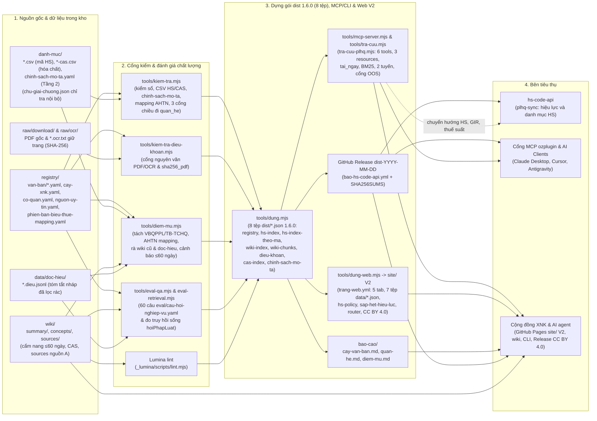
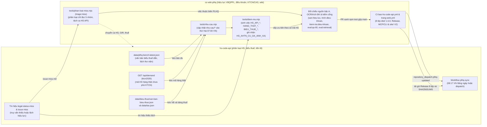

# Sơ đồ kiến trúc & ranh giới hệ thống (`oz-wiki-plhq`)

Tài liệu chuẩn hoá vai trò của **`oz-wiki-plhq`** trong hệ sinh thái tri thức hải quan – xuất nhập khẩu của OZ (từ Wave 1 đến Wave 29), làm rõ ranh giới tuyệt đối **0% trùng lặp** với **`hs-code-api`** và **Cổng MCP (`ozplugin` / client AI)**, dòng chảy gói dữ liệu máy `1.6.0` (**8 tệp** `dist/*.json`, kèm đồ thị sửa đổi cấp Điều khoản `data/sua-doi-dieu/` và `tai_ngay`), chuỗi thu thập toàn văn bậc A → OCR → trích xuất & kiểm nguyên văn điều khoản, máy chủ MCP Stdio (6 tools + **3 resources**) & CLI (`--tai-ngay`), bộ đánh giá (`eval:qa` 60 câu, `eval:retrieval` Okapi BM25, `eval:holdout` 48 ca mù), cổng tra cứu web V2 trên GitHub Pages và vòng lặp phản hồi hai chiều.

---

## Phần 1 — Bảng ranh giới tuyệt đối: `oz-wiki-plhq` ↔ `hs-code-api` ↔ Cổng MCP (`ozplugin`)

Ba thành phần hợp tác theo nguyên tắc **một nguồn sự thật cho từng miền bài toán** — không sao chép chồng chéo, không suy luận thay miền của nhau:

| Miền tri thức / Năng lực | `oz-wiki-plhq` (Kho tri thức PLHQ mở) | `hs-code-api` (Động cơ phân loại HS & biểu thuế) | Cổng MCP `ozplugin` & Client AI |
|---|---|---|---|
| **Hiệu lực VBQPPL & quan hệ cũ–mới** | **Nguồn gốc sự thật (`registry/van-ban/*.yaml`)**: 6 trạng thái hiệu lực, quan hệ chiều đi (`thay_the`, `sua_doi`, `bai_bo`, `tam_ngung`, `huong_dan`, `hop_nhat`) được kiểm tự động 3 cổng chiều đi trong `tools/kiem-tra.mjs`, cạnh ngược tính sẵn trong `dist/registry.json`, đối chiếu nguồn bậc A (`congbao.chinhphu.vn`, `vanban.chinhphu.vn`, `vbpl.vn`, cổng bộ). Cảnh báo văn bản sắp hết hiệu lực `≤60` ngày qua `tools/diem-mu.mjs`, `plhq_sap_het_hieu_luc` và `data/sap-het-hieu-luc.json` trên Web V2 | Tiêu thụ `dist/registry.json` qua `scripts/sync-plhq.mjs` (`plhq-sync`) để gắn `legalBasisRegistry` và cảnh báo `policyBasisReview` theo từng mã HS | Đọc nguyên giá trị `tinh_trang`, `het_hieu_luc_tu`, `xac_minh.hieu_luc_da_doi_chieu` (trực tiếp từ `dist/` hoặc qua `plhq_tra_hieu_luc` / `plhq_sap_het_hieu_luc`), **không tự suy luận lại hiệu lực** |
| **Thu thập toàn văn bậc A & OCR giữ trang** | **Chuỗi thu thập & kiểm toán `raw/`**: `tools/nap.mjs` (chặn ghi `.txt` giả từ vỏ HTML, hỗ trợ `--theo-pdf`), `tools/kiem-tra-nap.mjs` (kiểm toán 5 nhóm phủ toàn văn), `tools/tai-pdf-tu-vo-html.mjs` (tự động bóc PDF bậc A từ vỏ HTML, bỏ `vbpl.vn`, ưu tiên CDN Chính phủ, kiểm `%PDF`), `tools/ocr-raw.mjs` (`pdftoppm` + `tesseract -l vie+eng` ra `raw/ocr/*.ocr.txt` & `.ocr.json` giữ phân trang `\f`) | Không lưu trữ hay OCR bản PDF gốc văn bản quy phạm | Trỏ link tải bản gốc nguồn bậc A khi cần xác minh hoặc mở fallback lớp 2 |
| **Phân loại HS, 6 quy tắc GIR & Chú giải HS** | **KHÔNG phục vụ API hay web phân loại HS.** Riêng `danh-muc/chu-giai-chuong.json` (trích tiếng Việt từ Công báo TT `31/2022/TT-BTC` bằng `tools/trich-chu-giai.mjs`) **chỉ dùng tra cục bộ khi soạn wiki** (`node tools/chu-giai.mjs`), **tuyệt đối không xuất ra `dist/` hay `site/`**. Bộ lọc `laYeuCauThuocHsCodeApi` và khung cảnh báo Tab 5 Web V2 chủ động chuyển hướng mọi yêu cầu áp mã HS theo mô tả / GIR sang `hs-code-api` | **Nguồn gốc sự thật & động cơ phân loại**: 6 quy tắc tổng quát GIR (`lib/gir.js`), chú giải WCO EN, AHTN SEN (`ahtn_sen`), chú giải chương/nhóm 4 số, `/api/suggest`, `/api/classify`, `/api/describe` | Gọi `hs-code-api` cho mọi bài toán xác định mã HS từ mô tả hàng hoá, giải thích GIR và chú giải HS |
| **Biểu thuế XNK & ánh xạ AHTN cũ → EN2022** | **KHÔNG lưu hay tính thuế suất.** Chỉ giữ bản chụp rút gọn mã 8 số + mô tả dòng trong `nhu-cau/bieu-thue.json` (chụp từ `data/tax.json`) để kiểm tồn tại mã CSV (`HS_KHONG_TON_TAI`) và sinh `canh_bao_ma`; đồng thời duy trì `registry/phien-ban-bieu-thue-mapping.yaml` (`HS_AHTN_CU_DA_ANH_XA`) xuất thành `anh_xa_ahtn_cu` trong `dist/hs-index-theo-ma.json` chỉ để gợi ý đối chiếu sang EN2022 | **Nguồn sự thật biểu thuế (`data/tax.json`)**: thuế suất NK/ƯĐ/FTA/GTGT/TTĐB, tính thuế theo ngày đăng ký (`/api/tax`) | Gọi `hs-code-api` (`/api/tax`) để tra thuế suất và điều kiện hưởng ưu đãi thuế; dừng kết luận khi gặp `canh_bao_ma` và đối chiếu văn bản gốc |
| **Tiền lệ phân loại (TB-TCHQ, quốc tế, MiC)** | **Chỉ crawl thô & đóng gói lô kiểm chứng** ở đầu nguồn (`Luồng 11`: `data/customs/`, `tools/dong-goi-lo-tb-tchq.mjs`; `Luồng 12`: quốc tế & MiC). Chỉ xuất mật độ tham khảo bậc C vào `dist/hs-index-theo-ma.json`; `data/hs-policy.json` trên Web V2 **lược bỏ hoàn toàn** `tien_le_tb_tchq` & `ten` để giữ web nhẹ và tách rạch ròi ranh giới | **Kho hợp nhất & phục vụ tra cứu**: giữ `data/precedents.json` (gộp qua `merge-community.mjs`), kiểm `validate-community.mjs`, phục vụ `/api/precedents` và tra cứu tiền lệ | Gọi `hs-code-api` (`/api/precedents`) khi người dùng cần tiền lệ phân loại |
| **Điều khoản pháp lý có cấu trúc** | **Nguồn sự thật phân tách 2 tầng (`dist/dieu-khoan.json`)**: tầng `NGUYEN_VAN_NGUON_A` từ `xac_minh.dieu_khoan` (trích bằng `tools/trich-dieu-khoan.mjs` hoặc soát tay, được cổng `npm run kiem-tra:dieu-khoan` đối chiếu nguyên văn theo `trang_pdf` và băm `sha256_pdf` trước khi xuất) và tầng `TOM_TAT_NHAP` từ `data/doc-hieu/*.dieu.jsonl` (`da_soat: false`, đã lọc điều rác `laDieuRac`, chỉ dùng định vị điều luật). Hỗ trợ deep-link `#dk=<slug>:<dieu>` và nút sao chép trích dẫn chuẩn CC BY 4.0 trên Web V2 | Tiêu thụ điều khoản nguyên văn bậc A (vd `85/2026/TT-BTC`) để kiểm thử so khớp `lib/legal-basis.js` và trả `canCuPhapLy[]` | Đọc `dist/dieu-khoan.json` hoặc gọi `plhq_tra_dieu_khoan`; **chỉ trích nguyên văn tầng `NGUYEN_VAN_NGUON_A`**, gắn nhãn cảnh báo `da_soat: false` khi dùng `TOM_TAT_NHAP` |
| **Wiki nghiệp vụ PLHQ & tìm kiếm theo đoạn** | **Nguồn sự thật (`wiki/summary/`, `wiki/concepts/`, `wiki/sources/`)**: tổng hợp nghiệp vụ XNK có dẫn nguồn (gồm cẩm nang `van-ban-sap-het-hieu-luc-2026-2027`, `hoa-chat-tien-chat-cas-xnk` và hệ thống trang `sources/` nguồn bậc A), rà trang lỗi thời bằng `WIKI_DAN_VB_HET_HIEU_LUC`, đóng gói thành `dist/wiki-index.json` và `dist/wiki-chunks.json` kèm cờ `canh_bao_hieu_luc` | Không lưu trữ hay chia đoạn wiki nghiệp vụ | Đọc `dist/wiki-index.json` & `dist/wiki-chunks.json` hoặc gọi `plhq_hoi_phap_luat`; kiểm `canh_bao_hieu_luc` và `van_ban_lien_quan[]` trước khi trả lời |
| **Bảng phụ lục mã HS, hóa chất CAS & Tầng 2 theo mô tả** | **Nguồn sự thật (`danh-muc/*.csv`, `*-cas.csv`, `chinh-sach-mo-ta.yaml`)**: trích nguyên văn phụ lục KTCN, cấm, giấy phép, PVTM (`dist/hs-index.json`, `dist/hs-index-theo-ma.json`), bảng CAS (`dist/cas-index.json`) và Tầng 2 theo mô tả + 25 viết tắt PLHQ (`dist/chinh-sach-mo-ta.json`, mang `do_tin: "VUA_SUY_RA"`). Rút gọn thành `data/hs-policy.json` cho Tab 5 `chinh-sach-hs` trên Web V2 (chỉ tra theo mã HS **đã biết**) | Tiêu thụ `dist/hs-index*.json` (và tuỳ chọn `dist/chinh-sach-mo-ta.json`) để gắn nghĩa vụ KTCN/giấy phép theo tiền tố mã HS 4/6/8 số trên `/api/tax` | Gọi `plhq_chinh_sach_theo_hs` (chỉ khi đã có mã HS) và `plhq_tra_cas` (hoặc đọc `dist/hs-index-theo-ma.json`, `dist/cas-index.json`, `dist/chinh-sach-mo-ta.json`, vd NĐ `24/2026/NĐ-CP`) |
| **Cổng MCP Stdio & CLI tra cứu (kèm dự phòng 3 tầng & `tai_ngay`)** | **Cung cấp trực tiếp từ kho (`0` dependency mới)**: `tools/mcp-server.mjs` (`npm run mcp:server`, JSON-RPC 2.0, **6 tools + 3 resources** gồm `plhq://huong-dan/quy-trinh-agent`) và CLI `tools/tra-cuu.mjs` (`--tai-ngay`), dùng engine `tra-cuu-plhq.mjs` (`bm25-vi.mjs`, `hieu-luc-theo-ngay.mjs`, 2 tuyến `sap_co_hieu_luc`, cổng OOS `ngoai_pham_vi`, dự phòng 3 tầng `tim_van_ban_lop_2`) | Tiếp nhận các truy vấn bị `laYeuCauThuocHsCodeApi` chuyển hướng (áp mã HS theo mô tả, GIR 1–6, chú giải HS, thuế suất, tiền lệ) | Đọc `plhq://huong-dan/quy-trinh-agent` & `plhq://meta/luoc-do`; truyền `tai_ngay` cho tờ khai lịch sử; kết nối song song `oz-wiki-plhq` & `hs-code-api` đúng ranh giới |
| **Cổng tra cứu web công khai (`site/` — GitHub Pages)** | **Dựng cổng web tĩnh V2 `0` CDN (`npm run dung:web` → `site/`)** qua `.github/workflows/trang-web.yml` với **5 tab**: (1) Hiệu lực văn bản + lọc `≤60` ngày + **Tại ngày tờ khai (`reg-tai-ngay`)**, (2) Wiki & Hỏi đáp, (3) Điều khoản bậc A + copy trích dẫn CC BY 4.0 + badge `trang_thai_dieu` & `#dk=` jump + **Tại ngày (`dk-tai-ngay`)**, (4) Hóa chất CAS (`24/2026/NĐ-CP`), (5) Chính sách theo mã HS (`chinh-sach-hs` đọc `data/hs-policy.json`). Xuất `8` tệp `data/*.json` + mảnh `data/dk/*.json`. **Không phân loại HS hay tính thuế** | Vận hành API và giao diện tra mã HS, GIR, biểu thuế XNK và tiền lệ phân loại | Dẫn liên kết sâu tới nguồn bậc A và URL deep-link cổng PLHQ V2 khi cần; không dùng cổng web để thay API HS/thuế |
| **Đánh giá QA, đo truy hồi & phân loại `[miss]`** | **Chấm phủ PLHQ (`npm run eval:qa`, `60` câu `CH-01..CH-60`)**, **đo truy hồi sống (`npm run eval:retrieval`)** và **phân loại chỉ đọc (`npm run triage:miss`)** tách issue `[miss]` thành 5 nhóm (`DA_CO_TRONG_SO`, `THUOC_HS_CODE_API`, `THIEU_VAN_BAN_MOI`, `THIEU_WIKI_HOAC_DIEU_KHOAN`, `KHAC_CAN_RA_SOAT`) | Tiếp nhận các ca thuộc nhóm `THUOC_HS_CODE_API` (áp mã 8 số, biểu thuế, GIR, chú giải HS, tiền lệ) | Chuyển đúng tuyến câu hỏi khi phát hiện thiếu dữ liệu |
| **Tài liệu bản quyền WCO / AHTN SEN** | **Không nạp vào kho công khai.** Đánh dấu trong `xac_minh.nguon_rieng_tu` (vd trên `85/2026/TT-BTC`) để `tools/diem-mu.mjs` không báo thiếu giả | Mua bản quyền và xử lý riêng tư trong phạm vi nội bộ (`wco_compendium`, `ahtn_sen`) | Không trực tiếp lưu trữ bản gốc có bản quyền; nhận kết quả qua API được phép |
| **Ghi nguồn & miễn trừ trách nhiệm** | Xuất sẵn `giay_phep` (CC BY 4.0), `ghi_nguon_chuan`, `mien_tru` trong mọi tệp `dist/` `1.6.0`, mọi phản hồi MCP/CLI (`GHI_NGUON_CC_BY`, `MIEN_TRU_PHAP_LY`), chân trang `site/` và nút sao chép trích dẫn điều khoản nguồn A | Trả trạng thái kèm căn cứ pháp lý và nguồn trích | **Luôn hiển thị** miễn trừ ("tham khảo, không phải tư vấn pháp lý"), link nguồn bậc A và chuỗi ghi nguồn CC BY 4.0 |

> **Quy tắc bất biến về `chu-giai-chuong.json`:** `danh-muc/chu-giai-chuong.json` là công cụ phụ trợ cục bộ giúp người/agent đối chiếu thuật ngữ khi soạn wiki (`node tools/chu-giai.mjs`). Mọi thay đổi ở `tools/dung.mjs` và `tools/dung-web.mjs` **tuyệt đối không** tạo `chu-giai-hs.json` hay sao chép `chu-giai-chuong.json`, `hs-index.json`, `hs-index-theo-ma.json` thô vào `dist/` hoặc `site/`. (Trên `site/data/`, chỉ xuất `data/hs-policy.json` đã rút gọn riêng cho tra cứu chính sách theo mã HS đã biết.)

---

## Phần 2 — Sơ đồ kiến trúc dòng chảy tri thức

Toàn bộ dữ liệu đi qua các cổng kiểm tự động (sổ, quan hệ chiều đi `quan_he`, đồ thị sửa đổi cấp Điều `data/sua-doi-dieu/`, nguyên văn điều khoản `kiem-tra:dieu-khoan`, điểm mù, `eval:qa` & `eval:retrieval` **60 câu**, `eval:holdout` **48 ca mù**, Lumina lint), dựng gói dữ liệu máy `1.6.0` (**8 tệp** `dist/*.json` + `SHA256SUMS`), cung cấp trực tiếp qua Cổng MCP Stdio (6 tools + 3 resources) & CLI (`--tai-ngay`), phát hành GitHub Release bất biến và dựng cổng tra cứu web công khai V2 (`site/` với **8 tệp** `data/*.json`, mảnh `data/dk/*.json` và **5 tab**) trên GitHub Pages:

---

## Phần 3 — Sơ đồ luồng thu thập toàn văn bậc A, OCR & trích điều khoản nguyên văn

Từ Wave 9 trở đi, kho chuẩn hóa chuỗi khép kín từ kiểm toán hiện trạng tệp thô đến trích xuất và tự kiểm chứng nguyên văn `xac_minh.dieu_khoan` (không tạo `.txt` giả từ vỏ HTML và không bao giờ ghi đè PDF gốc trong `raw/download/`):

```mermaid
flowchart LR
  NAP["tools/nap.mjs\n(tải URL nguồn A -> raw/download/\n+ .nguon.json; chặn .txt giả từ vỏ HTML)"]
  KTN["tools/kiem-tra-nap.mjs\n(kiểm toán 5 nhóm phủ toàn văn\ntừ raw/ + registry/ + wiki/ + doc-hieu/)"]
  VO["Nhóm VO_HTML_CHUA_TAI_PDF\n(vỏ HTML/pdf.js chưa có PDF gốc)"]
  SCAN["Nhóm PDF_BAN_SCAN_CAN_OCR\n(PDF ảnh dưới 50 ký tự lớp chữ)"]
  TEXT["Nhóm CO_TOAN_VAN_CHUA_INGEST\n(PDF lớp chữ, .txt, .ocr.txt, .docx)"]
  TAIPDF["tools/tai-pdf-tu-vo-html.mjs\n(lọc nguồn bậc A, bỏ vbpl.vn,\nkiểm %PDF & khớp số hiệu/tiêu đề)"]
  OCR["tools/ocr-raw.mjs\n(pdftoppm -png -r 250 + tesseract vie+eng\nra raw/ocr/*.ocr.txt giữ từng trang + .ocr.json)"]
  TRICH["tools/trich-dieu-khoan.mjs\n(trích Điều N, đối chiếu chuanHoaKhopNguyenVan\n+ sha256_pdf -> xac_minh.dieu_khoan)"]
  SOAT["Biên soạn wiki/sources/*.md\n& kiểm 2 cổng cuối:\nkiem-tra:dieu-khoan + Lumina lint"]

  NAP --> KTN
  KTN -->|"vỏ HTML"| VO
  KTN -->|"PDF scan"| SCAN
  KTN -->|"đủ toàn văn"| TEXT
  VO --> TAIPDF
  TAIPDF -->|"PDF scan"| SCAN
  TAIPDF -->|"PDF lớp chữ"| TEXT
  SCAN --> OCR
  OCR --> TEXT
  TEXT --> TRICH
  TEXT --> SOAT
  TRICH --> SOAT
```

---

## Phần 4 — Sơ đồ vòng lặp phản hồi hai chiều

Hai kho tự động nuôi nhau theo chu kỳ: `hs-code-api` gửi tín hiệu sử dụng thực tế (`nhu-cau/*`, tín hiệu `legal-status-miss`) và các issue `[miss]` mở được công cụ chỉ đọc `phan-loai-miss` sàng lọc để giữ ranh giới 0% trùng lặp, còn `oz-wiki-plhq` đối chiếu nguồn bậc A, kiểm nguyên văn điều khoản, ánh xạ AHTN cũ → EN2022 và đẩy ngược bản chụp `dist-YYYY-MM-DD` (8 tệp), cập nhật MCP/CLI cùng cổng web tĩnh V2 `site/`:

---

## Phần 5 — Bảng công cụ, cổng kiểm & sản phẩm

| Nhóm | Lệnh / Tệp nguồn | Sản phẩm / Đầu ra | Vai trò trong hệ thống |
|---|---|---|---|
| **Kiểm sổ, mapping & chiều đi `quan_he`** | `npm run kiem-tra` (`tools/kiem-tra.mjs`) | Báo cáo lỗi/cảnh báo (chặn PR nếu lỗi) | Kiểm lược đồ 2.980+ tệp YAML, CSV HS/CAS, `danh-muc/chinh-sach-mo-ta.yaml` (`kiemChinhSachMoTa`), `registry/phien-ban-bieu-thue-mapping.yaml` (`kiemAnhXaAhtn`), nguồn bậc A và **3 cổng chiều đi `quan_he`** (chặn cạnh ngược thời gian, chặn `HIEN_PHAP`/`LUAT`/`NGHI_QUYET` dùng `huong_dan`, chỉ `VAN_BAN_HOP_NHAT` dùng `hop_nhat`) |
| **Kiểm nguyên văn điều khoản** | `npm run kiem-tra:dieu-khoan` (`tools/kiem-tra-dieu-khoan.mjs`) | Kết quả đối chiếu từng mục `xac_minh.dieu_khoan` | Kiểm độ dài/chỉ số `dieu`, xác thực `sha256_pdf` thuần Node trên mọi môi trường và so khớp nguyên văn theo `trang_pdf` khi có `pdftotext` hoặc `.ocr.txt`/`.txt` (an toàn trên CI Linux thiếu `pdftotext`) |
| **Thu thập, kiểm toán nạp & OCR bậc A** | `npm run nap` (`tools/nap.mjs`) `node tools/kiem-tra-nap.mjs` `node tools/tai-pdf-tu-vo-html.mjs` `node tools/ocr-raw.mjs` | `raw/download/` + `.nguon.json`, báo cáo 5 nhóm nạp, `raw/ocr/*.ocr.txt` + `.ocr.json` | Chặn tạo `.txt` giả từ vỏ HTML; kiểm toán 5 nhóm (`DA_INGEST_TRI_THUC`, `CO_TOAN_VAN_CHUA_INGEST`, `PDF_BAN_SCAN_CAN_OCR`, `VO_HTML_CHUA_TAI_PDF`, `THIEU_RAW`); tự động tải PDF bậc A từ vỏ HTML và OCR PDF scan giữ nguyên dấu phân trang `\f` |
| **Trích điều khoản & làm sạch `doc-hieu`** | `node tools/trich-dieu-khoan.mjs` `tools/gop-doc-hieu.py` | `xac_minh.dieu_khoan` trong YAML & `data/doc-hieu/*.dieu.jsonl` sạch | Tự trích điều khoản nguyên văn bậc A từ `.ocr.txt`/`.txt`/`.md`/PDF lớp chữ/`.docx` kèm tự kiểm chứng `chuanHoaKhopNguyenVan` + `sha256_pdf`; lọc bỏ dòng điều rác (`laDieuRac` / `la_rac_phu_luc`) ở tầng `TOM_TAT_NHAP` |
| **Phát hiện điểm mù** | `npm run diem-mu` (`tools/diem-mu.mjs` → `bao-cao/diem-mu.md`, `.json`) | Báo cáo điểm mù tách tầng & xếp ưu tiên | Tách riêng VBQPPL vs TB-TCHQ cá biệt (`TB_TCHQ_KHONG_NGUON_A`, `TB_TCHQ_CHUA_DOI_CHIEU`), ghi nhận `HS_AHTN_CU_DA_ANH_XA`, phát hiện `DOC_HIEU_DIEU_RAC`/`DOC_HIEU_THIEU_NGHIA_VU`, cảnh báo `SAP_HET_HIEU_LUC` (`≤60` ngày), rà `WIKI_DAN_VB_HET_HIEU_LUC` và `WIKI_CHUA_CO_VB_NEN_TANG` |
| **Đánh giá QA nghiệp vụ** | `npm run eval:qa` (`tools/eval-qa.mjs`) | Báo cáo Markdown / `--json` trên **60 câu** (`eval/cau-hoi-nghiep-vu.yaml`) | Đo độ phủ 3 tiêu chí trên `CH-01..CH-60`: `(a)` sổ `CON_HIEU_LUC` + `NGUON_A`, `(b)` trang wiki hiện hành, `(c)` có điều khoản `NGUYEN_VAN_NGUON_A` hoặc `TOM_TAT_NHAP` |
| **Đo chất lượng truy hồi sống** | `npm run eval:retrieval` (`tools/eval-retrieval.mjs`) | Báo cáo hit rate, `expiredTop1`, `pin`, `abbr`, `outOfScope` | Kiểm thử sống `hoiPhapLuat` trên **60 câu** nghiệp vụ + 5 câu ghim số hiệu + 5 câu viết tắt + 2 câu ngoài kho (ngưỡng: `expiredTop1 === 0`, `hitAny >= 95%`, `soHieuPinRate = 5/5`, `abbrQueriesRate = 5/5`, `outOfScopeFallbackRate = 2/2`) |
| **Phân loại issue `[miss]` & cắt chuyển hiệu lực** | `npm run triage:miss` (`tools/phan-loai-miss.mjs`) `npm run chuyen-hieu-luc` (`tools/chuyen-hieu-luc.mjs`) | Báo cáo Markdown / `--json` & cập nhật `tinh_trang` theo ngày (`--ghi`) | Phân loại issue `[miss]` thành 5 nhóm giữ biên `hs-code-api`; rà soát & cắt chuyển `CON_HIEU_LUC`/`CHUA_CO_HIEU_LUC` tại mốc ngày (dry-run mặc định, bảo vệ `HET_HIEU_LUC_MOT_PHAN`) |
| **Dựng gói máy `1.6.0` & báo cáo** | `npm run dung` (`tools/dung.mjs`) | **8 tệp** `dist/*.json` (`1.6.0`) + `bao-cao/cay-van-ban.md`, `bao-cao/quan-he.md` | Sinh `registry.json`, `hs-index.json`, `hs-index-theo-ma.json` (kèm `anh_xa_ahtn_cu`), `wiki-index.json`, `wiki-chunks.json`, `dieu-khoan.json` (kèm `trang_thai_dieu` & `lich_su_tac_dong`), `cas-index.json`, `chinh-sach-mo-ta.json` (`VUA_SUY_RA` + 25 viết tắt) |
| **Cổng MCP Stdio & CLI tra cứu** | `npm run mcp:server` (`tools/mcp-server.mjs`) `npm run tra-cuu` (`tools/tra-cuu.mjs`) (`tools/lib/tra-cuu-plhq.mjs`, `docs/mcp-server.md`) | JSON-RPC 2.0 MCP stdio (6 tools + **3 resources**) & CLI `--tai-ngay`, `--json` | Tra cứu hiệu lực hiện hành & tại ngày (`tai_ngay`), điều khoản tách 2 tầng kèm `trang_thai_dieu`, hỏi đáp PLHQ (BM25 + 2 tuyến `sap_co_hieu_luc` + cổng OOS + dự phòng 3 tầng), hóa chất CAS, chính sách theo mã HS đã biết, cảnh báo `≤60` ngày; chuyển hướng câu hỏi áp mã HS/GIR/thuế sang `hs-code-api` |
| **Dựng cổng tra cứu web tĩnh V2** | `npm run dung:web` (`tools/dung-web.mjs`, `tools/web-template/*`) | Thư mục `site/` (`.nojekyll`, `index.html`, `app.js`, `style.css`, `8` tệp `data/*.json` + `600` mảnh `data/dk/*.json`) | Cổng tra cứu công khai `0` CDN gồm **5 tab**, tải lười `wiki-chunks.json`, mục lục `dieu-khoan-index.json` + chia mảnh từng văn bản `data/dk/<tier>-<slug>.json` cho deep-link `#dk=`, dải cảnh báo `sap-het-hieu-luc.json`, `hs-policy.json` rút gọn và hash router |
| **Kiểm tra wiki Lumina** | `node _lumina/scripts/lint.mjs --summary` | Tóm tắt JSON (`L01..L22`) | Kiểm frontmatter, cấu trúc mục, thứ tự alphabet `wiki/index.md` và liên kết hai chiều toàn bộ `wiki/` |
| **Bộ kiểm thử tự động & CI/CD** | `npm test` (gồm `tools/test/*.mjs`, `scripts/*.mjs`) `.github/workflows/{kiem-tra,bao-hs-code-api,trang-web,bao-cao-tuan}.yml` | Kiểm PR, Release `dist-YYYY-MM-DD` (8 tệp + `SHA256SUMS`), GitHub Pages `site/`, báo cáo tuần | Tự động hóa kiểm thử (`run.mjs`, `tb-noi-dung-tb.mjs`, `test-mcp-dist.mjs`, `test-diem-mu-nang-cap.mjs`, `test-quan-he-chieu-di.mjs`, `test-dieu-khoan-nguyen-van.mjs`, `test-phan-loai-miss.mjs`, `test-dung-web.mjs`, `test-mcp-server.mjs`, `test-chuyen-hieu-luc.mjs`, `test-trich-dieu-khoan.mjs`, kiểm sổ/điều khoản/toàn vẹn registry/Lumina lint; kèm các bộ test bổ trợ `test-tra-cuu-plhq.mjs`, `test-kiem-tra-nap.mjs`, `test-ocr-raw.mjs`, `test-tai-pdf-tu-vo-html.mjs`), phát hành bản chụp `dist/` bất biến, đồng bộ `hs-code-api` và triển khai cổng web V2 |

---

## Phần 6 — Bản đồ lộ trình nâng cấp (Wave 1–24)

Lộ trình tập trung hoàn toàn vào **năng lực cốt lõi của `oz-wiki-plhq`** (hiệu lực VBQPPL, thu thập/OCR bậc A, điều khoản nguyên văn, danh mục HS/CAS & Tầng 2 mô tả, wiki PLHQ, cổng kiểm, đánh giá `eval:qa` & `eval:retrieval`, MCP/CLI và cổng tra cứu web tĩnh V2) — **đã cắt sạch mọi hạng mục trùng với `hs-code-api`**:

| Giai đoạn | Mục tiêu trọng tâm | Hạng mục triển khai chính | Tiêu chí đạt |
|---|---|---|---|
| **Giai đoạn 1** Khóa ranh giới & chuẩn kiểm soát *(Wave 1 & 2)* | Tách rạch ròi vai trò với `hs-code-api`; làm sạch điểm mù giả, cạnh ngược và wiki lỗi thời | 1. Tài liệu hoá ranh giới & kiến trúc (`docs/SO-DO-HE-THONG.md`). 2. Tách tầng VBQPPL vs TB-TCHQ cá biệt trong `tools/diem-mu.mjs`; thêm `WIKI_DAN_VB_HET_HIEU_LUC` và `WIKI_CHUA_CO_VB_NEN_TANG`. 3. Dọn sạch cạnh `quan_he` ngược thời gian/sai vai trò và đặt 3 cổng kiểm tự động trong `tools/kiem-tra.mjs`. 4. Dọn 12 trang wiki hết `WIKI_DAN_VB_HET_HIEU_LUC`; thiết lập `eval/cau-hoi-nghiep-vu.yaml` + `tools/eval-qa.mjs`. | `npm test`, `npm run kiem-tra`, `node _lumina/scripts/lint.mjs --summary` đạt 0 lỗi, 0 cảnh báo; `WIKI_DAN_VB_HET_HIEU_LUC = 0` |
| **Giai đoạn 2** Xuất gói dữ liệu máy `1.5.0` & CI Release *(Wave 1)* | Cung cấp giao diện dữ liệu máy sạch, tách tầng tin cậy cho Cổng MCP (`ozplugin`) | 1. Nâng `LUOC_DO_PHIEN_BAN` lên `'1.5.0'` trong `tools/lib/registry.mjs`. 2. Dựng `tools/lib/wiki-dist.mjs` & `tools/lib/dieu-khoan-dist.mjs`, tích hợp vào `tools/dung.mjs`. 3. Cập nhật `.github/workflows/bao-hs-code-api.yml` kiểm hash, phát hành gói `dist/*.json` + `SHA256SUMS` vào Release `dist-YYYY-MM-DD`. 4. Chuẩn hoá hợp đồng trường trong `docs/tich-hop.md` & `docs/luoc-do-so-dang-ky.md`. | Các tệp `dist/*.json` mang `luoc_do_phien_ban: "1.5.0"`, không tồn tại `chu-giai-hs.json` hay `chu-giai-chuong.json` trong `dist/` |
| **Giai đoạn 3** Phủ sâu & kiểm nguyên văn điều khoản nguồn A *(Wave 3)* | Nâng tỷ trọng câu trả lời đạt căn cứ nguyên văn bậc A (`NGUYEN_VAN_NGUON_A`) và khóa kiểm nguyên văn | 1. Dựng cổng `tools/kiem-tra-dieu-khoan.mjs` (`npm run kiem-tra:dieu-khoan`) đối chiếu nguyên văn theo `trang_pdf` và băm `sha256_pdf` (an toàn khi CI thiếu `pdftotext`). 2. Trích nguyên văn `xac_minh.dieu_khoan` từ PDF bậc A cho các văn bản khung (`38/2015/TT-BTC`, `121/2025/TT-BTC`, `39/2015/TT-BTC`, `108/2025/QH15`, `11/2026/QH16`, `31/2026/QĐ-TTg`, `124/2026/TT-BTC`, `33/2025/TT-BCT`, `28/2026/TT-BCT`, `49/2026/TT-BXD`, `85/2026/TT-BTC`). 3. Bổ sung concept `thu-tuc-tai-cua-khau-nhap`, `thue-chong-ban-pha-gia-thep` và làm sạch dẫn chiếu cũ ở `wiki/sources/`. | `npm run kiem-tra:dieu-khoan` 0 lỗi; tăng mạnh `DAT_NGUON_A` trên `eval:qa` |
| **Giai đoạn 4** Cổng web V1 & phân loại `[miss]` *(Wave 4)* | Phục vụ cộng đồng XNK qua cổng web tĩnh và tự động hóa sàng lọc `[miss]` | 1. Dựng cổng tra cứu web tĩnh `0` CDN (`tools/dung-web.mjs`, `npm run dung:web` → `site/`) và triển khai GitHub Pages tự động qua `.github/workflows/trang-web.yml`. 2. Tạo công cụ chỉ đọc `tools/phan-loai-miss.mjs` (`npm run triage:miss`) phân loại issue `[miss]` thành 5 nhóm để giữ biên với `hs-code-api`. | `site/` triển khai sạch lên GitHub Pages, `triage:miss` tách đúng biên `hs-code-api` |
| **Giai đoạn 5** Cổng MCP Stdio, CLI & `eval:retrieval` *(Wave 5 & 5+)* | Cung cấp giao diện MCP/CLI thuần Node, dự phòng 3 tầng và cổng đo truy hồi sống | 1. Xây dựng `tools/lib/tra-cuu-plhq.mjs` (`0` dependency mới, bộ lọc `laYeuCauThuocHsCodeApi`, `GHI_NGUON_CC_BY`, `MIEN_TRU_PHAP_LY`, dự phòng 3 tầng `tim_van_ban_lop_2` + `[BỔ SUNG SỔ]`). 2. Dựng `tools/mcp-server.mjs` (`npm run mcp:server`, newline JSON & `Content-Length`, 6 tools + 2 resources), `tools/tra-cuu.mjs` (`npm run tra-cuu`) và `tools/eval-retrieval.mjs` (`npm run eval:retrieval`). 3. Viết `docs/mcp-server.md` và bộ test `test-mcp-server.mjs` + `test-tra-cuu-plhq.mjs`. | `test-mcp-server.mjs` & `eval:retrieval` xanh; tách tuyệt đối 2 tầng điều khoản; chuyển hướng HS/GIR/thuế sang `hs-code-api` |
| **Giai đoạn 6** Cẩm nang thực chiến & mở rộng bộ QA 60 câu *(Wave 6 & 6+)* | Mở rộng tri thức sắp hết hiệu lực, hóa chất/CAS và nâng chuẩn đánh giá lên 60 câu | 1. Tạo cẩm nang `wiki/summary/van-ban-sap-het-hieu-luc-2026-2027.md` và `wiki/concepts/hoa-chat-tien-chat-cas-xnk.md` (`24/2026/NĐ-CP`, `28/2026/NĐ-CP`, `33/2024/NĐ-CP`, `34/2024/NĐ-CP`, `73/2021/QH14`). 2. Biên soạn các trang `wiki/sources/*.md` mới (`124-2026-tt-btc`, `143-2026-nd-cp`, `186-2026-nd-cp`, `19-2026-qh16`, `31-2026-qd-ttg`, `154-2026-tt-btc`, `372-2026-nd-cp`, `63-2026-tt-bkhcn`...). 3. Mở rộng `eval/cau-hoi-nghiep-vu.yaml` lên **60 câu** (`CH-01..CH-60`). | Lumina lint `0` lỗi `0` cảnh báo; `WIKI_DAN_VB_HET_HIEU_LUC = 0`; `WIKI_NHAC_CHUA_DANG_KY = 0` |
| **Giai đoạn 7** Cổng Web Xã hội V2 *(Wave 7)* | Nâng cấp cổng web tĩnh thành công cụ tra cứu liên kết sâu 5 tab, cảnh báo hạn và trích dẫn 1-click | 1. Cập nhật `tools/dung-web.mjs` xuất đủ `7` tệp `data/*.json` (thêm `data/hs-policy.json` bỏ `ten` & `tien_le_tb_tchq` và `data/sap-het-hieu-luc.json` lọc hạn `≤60` ngày). 2. Nâng `tools/web-template/*`: dải cảnh báo đầu trang, lọc `≤60` ngày ở Tab 1, **Tab 5 `chinh-sach-hs`**, deep-link hash router (`#vb=`, `#wiki=`, `#dk=`, `#cas=`, `#hs=`, `#tab=`), nút copy liên kết và trích dẫn CC BY 4.0 cho tầng `NGUYEN_VAN_NGUON_A`. | `node tools/test/test-dung-web.mjs` & `npm test` xanh toàn phần; `0` CDN ngoài; `0` `chu-giai-hs.json`/`chu-giai-chuong.json` |
| **Giai đoạn 8** Ánh xạ AHTN, Tầng 2 mô tả & lọc rác `doc-hieu` *(Wave 8)* | Đóng gói đủ **8 tệp** `dist/*.json` `1.5.0`, chuẩn hoá mapping AHTN cũ → EN2022 và làm sạch `TOM_TAT_NHAP` | 1. Tạo `registry/phien-ban-bieu-thue-mapping.yaml` (nối vào `anh_xa_ahtn_cu` trong `dist/hs-index-theo-ma.json`, kiểm bằng `kiemAnhXaAhtn` trong `kiem-tra.mjs`, tách `HS_AHTN_CU_DA_ANH_XA` trong `diem-mu.mjs`). 2. Tạo `danh-muc/chinh-sach-mo-ta.yaml` + `tools/lib/chinh-sach-mo-ta.mjs` xuất tệp thứ 8 `dist/chinh-sach-mo-ta.json` (`VUA_SUY_RA` + `TU_DIEN_VIET_TAT_PLHQ` 25 viết tắt). 3. Thêm `laDieuRac` / `la_rac_phu_luc` trong `dieu-khoan-dist.mjs`, `gop-doc-hieu.py` và `DOC_HIEU_DIEU_RAC`/`DOC_HIEU_THIEU_NGHIA_VU` trong `diem-mu.mjs`. | Đủ **8 tệp** `dist/*.json` (`1.5.0`), `test-mcp-dist.mjs` & `test-diem-mu-nang-cap.mjs` xanh |
| **Giai đoạn 9** Chuỗi nạp bậc A, OCR giữ trang & trích điều khoản tự động *(Wave 9–15)* | Đưa toàn văn bậc A từ vỏ HTML / PDF scan thành `xac_minh.dieu_khoan` và `wiki/sources/` đã đối chiếu | 1. Dựng `tools/kiem-tra-nap.mjs` + `tools/lib/kiem-tra-raw.mjs` (kiểm toán 5 nhóm) và chặn `.txt` giả cho vỏ HTML trong `tools/nap.mjs`. 2. Dựng `tools/tai-pdf-tu-vo-html.mjs` (tải PDF bậc A từ vỏ HTML), `tools/ocr-raw.mjs` (OCR giữ phân trang `\f` ra `raw/ocr/`) và `tools/trich-dieu-khoan.mjs` (tự trích & kiểm `chuanHoaKhopNguyenVan` + `sha256_pdf`). 3. Dọn sạch `DOC_HIEU_DIEU_RAC`, nâng cấp stub `wiki/sources/`, nạp PDF/OCR cho văn bản nền tảng & VBHN. | `kiem-tra-nap` sạch `VO_HTML_CHUA_TAI_PDF` & `PDF_BAN_SCAN_CAN_OCR`; `kiem-tra:dieu-khoan` 0 lỗi |
| **Giai đoạn 10** Tối ưu truy hồi, phủ AHTN/wiki & đồng bộ toàn diện *(Wave 15–16)* | Đưa hệ thống vào trạng thái nhất quán 100% giữa mã nguồn, kiểm thử và tài liệu | 1. Cải tiến xếp hạng truy hồi trong `tools/lib/tra-cuu-plhq.mjs` hướng tới `eval:retrieval` đạt tối đa trên 60 câu, chuẩn hoá liên kết mọi suite test vào `npm test`. 2. Phủ ánh xạ AHTN cũ → EN2022 (`phien-ban-bieu-thue-mapping.yaml`), bổ sung `nghia_vu_xnk` trong `data/doc-hieu/` và mở rộng `wiki/sources/` cho văn bản nền tảng/CBPG/nghị định còn hiệu lực. 3. Đồng bộ 100% `README.md`, `docs/SO-DO-HE-THONG.md`, `docs/tich-hop.md` và `docs/mcp-server.md`. | `npm test` & Lumina lint xanh; 4 tài liệu và sơ đồ Mermaid khớp 100% thực tế |
| **Giai đoạn 11** Phủ 100% điều khoản đầy đủ nguồn A & 100% ingest VB hiện hành *(Wave 17–22)* | Đóng toàn bộ khoảng trống toàn văn/điều khoản nguồn A, issue `[miss]`, điểm mù liên kết wiki & chú giải Phần HS 2022 | 1. Bổ sung `tools/trich-dieu-khoan-day-du.mjs` & `data/dieu-khoan-day-du/*.dieu.jsonl` phủ 100% điều khoản nguyên văn nguồn A (`9.587+` điều), bật cổng CI `kiem-tra-dieu-khoan` bắt buộc `pdftotext` (`#752`, `#755`). 2. Đóng toàn bộ **16 `THIEU_RAW`** & 6 issue `[miss]`, đưa `DA_INGEST_TRI_THUC` lên **100%** văn bản hiện hành (`THIEU_RAW = 0`, `#756`). 3. Trích Chú giải Phần HS 2022 (`21/21` Phần, chỉ tra nội bộ, `#754`), dọn `WIKI_NHAC_CHUA_DANG_KY = 0`, `DOC_HIEU_THIEU_NGHIA_VU = 0` và đồng bộ tài liệu Wave 22 (`#757`). | `THIEU_RAW = 0`, `WIKI_NHAC_CHUA_DANG_KY = 0`, `DOC_HIEU_THIEU_NGHIA_VU = 0`, `kiem-tra` 0 lỗi 0 cảnh báo |
| **Giai đoạn 12** Truy hồi 60/60, tải lười/chia mảnh Web V2 & chuyển tiếp 2026–2027 *(Wave 23–24)* | Đạt `100%` `eval:retrieval`, tối ưu băng thông tải Web V2 và tự động hóa kịch bản cắt chuyển hiệu lực cuối năm | 1. Bổ sung liên kết chéo wiki có dẫn nguồn nâng `eval:retrieval` `hitAll` từ `57/60` lên **`60/60 (100.0%)`**, giữ `hitTop1 = 60/60`, `expiredTop1 = 0/60` (`#758`). 2. Tối ưu Web V2: xuất `data/dieu-khoan-index.json` + **600+** mảnh `data/dk/<tier>-<slug>.json`, tải lười `wiki-chunks.json` (Tab 2) và `dieu-khoan.json` (chỉ khi tìm từ khóa toàn văn ở Tab 3). 3. Xây dựng `tools/chuyen-hieu-luc.mjs` (`npm run chuyen-hieu-luc`, dry-run mặc định, bảo vệ `HET_HIEU_LUC_MOT_PHAN`) và cập nhật cẩm nang chuyển tiếp `2026–2027` (`updated: 2026-11-25`). | `eval:retrieval` `60/60` trên mọi chỉ tiêu; `test-dung-web` & `test-chuyen-hieu-luc` xanh; sẵn sàng mốc `31/12/2026 → 01/01/2027` |
| **Giai đoạn 13** Đồ thị sửa đổi cấp Điều `1.6.0`, BM25, `--tai-ngay`, MCP `ozplugin` & Web V2 *(Wave 25–29)* | Kiểm chứng định lượng bằng holdout mù, dựng đồ thị sửa đổi cấp Điều, BM25 + 2 tuyến, hiệu lực tại ngày và nâng cấp MCP/`ozplugin` + Web V2 | 1. **Wave 25 (`#760`):** Xây bộ **48 ca holdout mù** (`eval/holdout-thuc-chien.yaml`, `eval:holdout --strict`) và sửa bộ trích điều khoản sửa đổi đa khoản. 2. **Wave 26 (`#761`):** Xây đồ thị `data/sua-doi-dieu/*.json` (67 tệp / 1.243 tác động), nâng lược đồ `1.6.0` (tương thích ngược `1.x`), gắn `trang_thai_dieu` & `lich_su_tac_dong` vào `dieu-khoan.json`. 3. **Wave 27 (`#762`):** Okapi BM25 (`bm25-vi.mjs`), tách 2 tuyến `sap_co_hieu_luc`, đa dạng hóa IDF, cổng OOS (`ngoai_pham_vi: true`) kéo `eval:holdout --strict` từ `31/48 (64,6%)` lên **`46/48 (95,8%)`** và `eval:retrieval` **`60/60 (100%)`**. 4. **Wave 28 (`#763`):** `hieu-luc-theo-ngay.mjs` + 27 mốc `tu_ngay`, hỗ trợ `--tai-ngay` / `tai_ngay` xuyên suốt tra cứu, CLI & 4 MCP tools. 5. **Wave 29:** Tối đa hỗ trợ MCP/`ozplugin` (resource `plhq://huong-dan/quy-trinh-agent`, enriched `meta/luoc-do`, renderer `sap_co_hieu_luc` & `ngoai_pham_vi`) + Web V2 (`trang_thai_dieu` badge, nút nhảy `#dk=`, bộ lọc `tai_ngay` Tab 1 & Tab 3). | `npm test`, `eval:retrieval` `60/60`, `eval:holdout --strict` `46/48 (95,8%)`, 3 workflow `main` xanh |

### Các phần đã cắt bỏ khỏi lộ trình (thuộc ranh giới `hs-code-api`)

- **Không** xuất `chu-giai-chuong.json`, `chu-giai-hs.json`, WCO Explanatory Notes hay AHTN SEN ra `dist/` hoặc `site/` (và `data/hs-policy.json` trên Web V2 chỉ giữ văn bản chính sách theo mã HS **đã biết**, lược bỏ `ten` mô tả dòng & `tien_le_tb_tchq`).
- **Không** dựng API, trang web hoặc bộ máy gợi ý / áp mã HS theo mô tả hàng hoá hay 6 quy tắc GIR (mọi đầu vào không phải mã số trên Tab 5 hoặc câu hỏi áp mã ở MCP/CLI đều bị chuyển hướng sang `hs-code-api`).
- **Không** lưu trữ hoặc tính toán thuế suất biểu thuế XNK trong `oz-wiki-plhq`.
- **Không** tự phục vụ chỉ mục tiền lệ phân loại thay cho `/api/precedents` của `hs-code-api` (`oz-wiki-plhq` chỉ dừng ở crawl/đóng gói lô theo Luồng 11 và Luồng 12).
