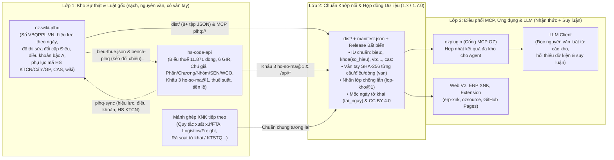

# Tầm nhìn, Sứ mệnh & Kế hoạch Liên kết Hệ sinh thái XNK OZ (`oz-wiki-plhq` ↔ `hs-code-api` ↔ `ozplugin`)

> **Tài liệu định hướng kiến trúc toàn chuỗi (26/11/2026):** Xác lập tầm nhìn, sứ mệnh chung và lộ trình **Wave 30–33** biến các kho tri thức của OZ thành **một khối sự thật liên kết chặt chẽ, 0% trùng lặp**, bổ trợ trực tiếp cho nhau qua ID chuẩn, vân tay nội dung, cạnh liên kết và giao thức MCP — để **kho giữ sự thật sạch & cấu trúc chắc, còn LLM đảm nhận nhận thức và suy luận**.

---

## Phần 1 — Tầm nhìn & Sứ mệnh chung của chuỗi dự án XNK OZ

### 1.1. Tầm nhìn

Xây dựng **hệ sinh thái tri thức & công cụ xuất nhập khẩu Việt Nam** dạng **mô-đun lắp ghép (plug-and-play)**: mỗi kho phụ trách duy nhất một miền sự thật pháp lý hoặc nghiệp vụ, nói chuyện với nhau bằng chuẩn ID, nhãn lớp dữ liệu và vân tay SHA-256 thống nhất, để mọi trợ lý AI (`ozplugin` / MCP client) và phần mềm nội bộ (`erp-xnk`, `ozsource`…) tiếp cận toàn bộ bài toán thông quan mà **không bịa luật, không trộn lẫn, và dễ dàng ghép thêm mảnh mới**.

### 1.2. Nguyên lý cốt lõi: *“Kho giữ sự thật sạch — LLM lo nhận thức & suy luận”*

Thống nhất cùng `ADR-0005` (*Repo là bản đồ luật, LLM là người đọc*) và `ADR-0006` (*Hồ sơ vấn đề tách khỏi dữ liệu khách*) của `hs-code-api`:

1. **Tách tuyệt đối Dữ liệu luật khỏi Suy luận nhận thức:** Kho dữ liệu **chỉ** thu thập toàn văn nguồn bậc A, chuẩn hoá cấu trúc, tính vân tay, dựng cạnh liên kết (cũ–mới, sửa đổi cấp Điều, phụ lục mã HS/CAS) và trả trích dẫn nguyên văn nhanh, chính xác. **Không** viết mẹo từ khoá, không nhồi lời diễn giải AI hay tự ý suy luận thay LLM trên lớp sự thật. Việc đọc hiểu ngữ cảnh hàng hoá, cân nhắc đa điều kiện và trả lời người khai là phần việc của LLM thông qua MCP.
2. **Dữ liệu khách đi theo đường riêng:** Hồ sơ sự thật pháp lý (VBQPPL, biểu thuế, chú giải WCO/HS, danh mục KTCN) tách khỏi tờ khai, mô tả hàng hoá thực tế và tiền lệ thông báo phân loại (`TB-TCHQ` giữ nhãn lớp riêng là tham khảo bậc C / `TIEN_LE`).
3. **Liên kết chặt qua mã định danh, vân tay & cạnh:** Khi một quy định thay đổi ở bất kỳ kho nào, vân tay nội dung (`SHA-256`) và quan hệ có hướng giúp mọi kho liên kết và `ozplugin` biết ngay *chỗ nào đổi, văn bản nào liên quan, điều khoản nào còn hiệu lực tại ngày tờ khai (`tai_ngay`)*.
4. **Cắm thêm mảnh ghép mới không phá lõi cũ:** Kiến trúc mở theo chuẩn chung sẵn sàng cho các mảnh ghép tiếp theo trong chuỗi XNK (quy tắc xuất xứ & C/O ưu đãi FTA, giá cước & logistics `oz-freight-api`, rà soát tờ khai & kiểm tra sau thông quan, đặt hàng & nguồn hàng `ozsource`, điều hành `erp-xnk`…).

---

## Phần 2 — Phân công đơn nhiệm & Sơ đồ khối liên kết

Mỗi dự án trong chuỗi giữ đúng một vai — **0% chồng chéo**:

### Bảng ranh giới *Làm gì / Không làm gì*

| Thành phần | Chuyên trách (LÀM) | Ranh giới cấm (KHÔNG LÀM) |
|---|---|---|
| **`oz-wiki-plhq`** | Giữ kho VBQPPL XNK sạch & cập nhật; hiệu lực toàn văn & tại ngày (`tai_ngay`); đồ thị sửa đổi cấp Điều; điều khoản nguyên văn nguồn A (`NGUYEN_VAN_NGUON_A`); phụ lục mã HS KTCN/Cấm/GP/PVTM; danh mục hoá chất CAS; chuẩn bị luồng trích dẫn, cạnh liên kết & vân tay cho kho khác; wiki nghiệp vụ. | Không phân loại/áp mã HS theo mô tả hàng; không giải 6 quy tắc GIR/Chú giải WCO; không tính thuế suất; không xây động cơ suy luận thay LLM; không lưu dữ liệu khách/tờ khai. |
| **`hs-code-api`** | Giữ luật gốc phân loại HS & biểu thuế (11.871 dòng, Phần/Chương/Nhóm/SEN/WCO, GIR 1–6); dựng **Khâu 3 `ho-so-ma@1`**; tính thuế suất XNK & quản lý tiền lệ phân loại (`TB-TCHQ`). Tiêu thụ hiệu lực & phụ lục VBQPPL từ `oz-wiki-plhq`. | Không làm lại sổ 3.277+ VBQPPL VN hay tự suy hiệu lực thông tư/nghị định; không cào/OCR nguồn bậc A pháp luật VN thay `oz-wiki-plhq`. |
| **`ozplugin` & LLM** | Điều phối đồng thời MCP của `hs-code-api`, `oz-wiki-plhq` và các mảnh ghép mới; giao phần đọc hiểu nguyên văn luật, gộp câu hỏi thiếu dữ kiện (`duKien`) và kết luận cho LLM. | Không tự bịa điều luật hay hiệu lực ngoài dữ liệu có trích dẫn nguồn A + ngày dữ liệu + miễn trừ pháp lý. |
| **Mảnh ghép tương lai** | Mỗi kho mới (Xuất xứ FTA/C/O, Logistics `oz-freight-api`, KTSTQ…) chỉ giữ sự thật chuyên miền, dùng chung chuẩn ID/vân tay/lớp kho để cắm thẳng vào Cổng `ozplugin`. | Không sao chép lại biểu thuế của `hs-code-api` hay sổ VBQPPL của `oz-wiki-plhq`. |

---

## Phần 3 — 5 Chuẩn khớp nối kỹ thuật giữa các kho

Để bất kỳ kho nào (hiện tại là `hs-code-api` + `ozplugin`, sau này là các mảnh ghép XNK mới) cắm vào đều ăn khớp ngay không phải viết bộ chuyển đổi chắp vá, `oz-wiki-plhq` chuẩn hoá 5 quy ước sau:

1. **ID định danh dùng chung giữa các kho:**
   - Văn bản pháp quy: khoá chuẩn `khoa(so_hieu)` (viết hoa, bỏ dấu `Đ→D`, bỏ khoảng trắng — đồng bộ 100% giữa `tools/lib/registry.mjs` và `hs-code-api/lib/plhq-registry.js`).
   - Điều khoản bậc A: `vb:<slug>:d:<dieu>[:k:<khoan>][:dm:<diem>]`.
   - Nút biểu thuế trên phụ lục mã HS: `bieu:<ma_4_6_8_so>` (khớp thẳng ngữ pháp nút của `hs-code-api/lib/ho-so-ma/ghep.js`).
   - Hoá chất CAS: `cas:<ma_cas>` (kèm phụ lục `I..IV`).
2. **Vân tay nội dung (`van`: SHA-256):**
   - Khớp nguyên lý Cổng 5 của Khâu 3 (`ho-so-ma@1`): mỗi điều khoản `NGUYEN_VAN_NGUON_A` và mỗi dòng phụ lục mã HS/CAS đều có vân tay `sha256` trên nội dung chuẩn hoá. Khi VBQPPL hay phụ lục sửa chữ nào, kho liên kết chỉ cần dựng lại đúng nút dính vân tay thay đổi.
3. **Nhãn phân lớp dữ liệu chống lẫn (`lop_du_lieu` chuẩn `lop-kho@1`):**
   - Mỗi tệp và mỗi khối trong gói xuất `dist/` phải mang rõ phân lớp tương thích với `hs-code-api` (`LUAT`, `RUT_TU_LUAT`, `BO_TRO`, `TIEN_LE`, `KY_THUAT`). Tuyệt đối không trộn tiền lệ bậc C (`tien_le_tb_tchq`) hay gợi ý mô tả (`BO_TRO`) chung vào khối `LUAT`.
4. **Kỷ luật thời gian (`tai_ngay`) & vòng đời biểu thuế (`phien_ban_ahtn`):**
   - Mọi truy vấn có thể đối chiếu theo ngày đăng ký tờ khai (`YYYY-MM-DD`) và phải trung thực báo `THIEU_NGAY_HIEU_LUC` khi nguồn gốc thiếu ngày hết hiệu lực, không suy đoán mù.
   - Mọi bảng `danh_muc_hs` khai rõ `phien_ban_ahtn` (`AHTN_2017` / `AHTN_2022` / `AHTN_2028`) để đón cập nhật biểu thuế hằng năm & chuyển đổi **HS 2028** mà không gãy dữ liệu cũ.
5. **Phát hành bất biến, có `manifest` & ghi nguồn mở:**
   - Phát hành đồng bộ qua GitHub Release `dist-YYYY-MM-DD` kèm `dist/manifest.json` và `SHA256SUMS`; giữ trọn chuỗi **CC BY 4.0** và **Miễn trừ pháp lý**.

---

## Phần 4 — Kế hoạch nâng cấp phía `oz-wiki-plhq` (Wave 30 → Wave 33)

Các bước triển khai đi từ chắc lõi dữ liệu đến mở rộng liên kết hệ sinh thái, **không đụng đường phân loại HS của `hs-code-api`**:

### Wave 30 — Chuẩn hoá Vân tay `van`, ID liên kho & Phân lớp `lop_du_lieu` (Lược đồ `1.7.0`)
- **Mục tiêu:** Mọi tệp máy của `oz-wiki-plhq` cắm vào `hs-code-api` (đặc biệt cổng `test-lop-kho.mjs` và Khâu 3 `ho-so-ma@1`) là **khớp ngay về ID, vân tay và lớp tin cậy**.
- **Hạng mục chính:**
  - Nâng `LUOC_DO_PHIEN_BAN` tương thích ngược lên `1.7.0` (giữ major `1.x`).
  - Sinh `id` chuẩn và `van` (`sha256(noi_dung)`) cho từng điều khoản `NGUYEN_VAN_NGUON_A` trong `dist/dieu-khoan.json` và cho từng dòng phụ lục trong `dist/hs-index*.json`.
  - Gắn `nut_bieu: "bieu:<ma_hs>"` trên chỉ mục mã HS; gắn trường `lop_du_lieu` chuẩn `lop-kho@1` trên từng tệp/khối `dist/*.json`; tách riêng khối `TIEN_LE` (`tien_le_tb_tchq`) khỏi nhánh `LUAT` chính để bên tiêu thụ nạp sạch vào `data/`.
  - Sinh `dist/manifest.json` (ghi `phien_ban`, `luoc_do_phien_ban`, `bieu_thue_doi_chieu`, `lop_du_lieu` và `sha256` từng tệp `dist/*.json`), đính kèm tự động trong GitHub Release `dist-YYYY-MM-DD`.

### Wave 31 — Luồng trích dẫn & Cạnh liên kết thuần dữ liệu phục vụ MCP (`ozplugin`)
- **Mục tiêu:** Khi `ozplugin` chuyển một mã HS đã biết từ `hs-code-api` sang `oz-wiki-plhq`, kho trả về ngay **đủ cạnh liên kết nguyên văn** (văn bản ↔ phụ lục ↔ điều khoản nguồn A ↔ chuỗi sửa đổi cấp Điều) để **LLM tự đọc và suy luận** — không thêm tầng heuristic/AI đoán mặt hàng ở `oz-wiki-plhq`.
- **Hạng mục chính:**
  - Làm rõ cấu trúc trả về thuần dữ liệu của `plhq_chinh_sach_theo_hs` tại ngày `tai_ngay`: phân nhóm theo sự thật trạng thái & `loai_tac_dong` (`dang_ap_dung`, `cat_giam`, `het_hieu_luc_hoac_sap_co_hieu_luc`) kèm nguyên văn `dieu_kien`, `mo_ta`, `nguon_bac_a`, cờ `can_kiem_cas` khi mã thuộc chương hoá chất (`28, 29, 38…`).
  - Bổ sung liên kết 2 chiều từ dòng phụ lục (`dan_chieu`, `dieu`/`khoan`) trỏ thẳng tới `id` điều khoản `NGUYEN_VAN_NGUON_A` & đồ thị `trang_thai_dieu` (`data/sua-doi-dieu/*.json`).
  - Giữ `dist/chinh-sach-mo-ta.json` đúng vai trò `BO_TRO` (không phình thành bộ máy từ khoá đoán hàng).
  - Cập nhật `plhq://huong-dan/quy-trinh-agent` với quy trình phối hợp 3 bước giữa `hs-code-api` (Khâu 3 `ho-so-ma@1`) ↔ `oz-wiki-plhq` (MCP `1.7.0`) ↔ LLM/`ozplugin`.

### Wave 32 — Vòng đời Biểu thuế hằng năm & Sẵn sàng HS 2028
- **Mục tiêu:** Đảm bảo 43+ bảng phụ lục HS (`danh-muc/*.csv`) theo kịp thay đổi biểu thuế VN hằng năm và lần chuyển đổi **HS 2028** sắp tới.
- **Hạng mục chính:**
  - Khai báo `phien_ban_ahtn` (`AHTN_2017` / `AHTN_2022` / `AHTN_2028`) cho metadata `danh_muc_hs` trong `registry/van-ban/*.yaml`.
  - Siết bộ kiểm `tools/diem-mu.mjs` với bản chụp `nhu-cau/bieu-thue.json` mỗi khi `hs-code-api` đổi biểu thuế để khoanh vùng chính xác dòng CSV cần ánh xạ qua `registry/phien-ban-bieu-thue-mapping.yaml`.
  - Phối hợp `hs-code-api` đóng dứt điểm 1 ca nghi lệch số hiệu còn lại (`45/2024/TT-BCT`).

### Wave 33 — Vận hành nền 12 luồng & Mở rộng cho Mảnh ghép mới
- **Mục tiêu:** Duy trì nhịp cập nhật văn bản 2026–2027 (trọng tâm mốc cắt chuyển `31/12/2026 → 01/01/2027`), đồng bộ nâng cấp `hs-code-api` và chuẩn hoá khuôn cho các repo kế tiếp trong hệ sinh thái.
- **Hạng mục chính:**
  - Vận hành đều 12 luồng trong [docs/luong-cong-viec.md](luong-cong-viec.md): nạp kịp thời VBQPPL mới, phụ lục KTCN mới (`Luồng 10`), giữ đồ thị `data/sua-doi-dieu/` và `xac_minh.dieu_khoan` đạt chuẩn bậc A.
  - Hỗ trợ PR nâng `scripts/sync-plhq.mjs` bên `hs-code-api` lên chuẩn `1.7.0` (đọc qua Release bất biến + `dist/manifest.json`, giữ `quan_he`, `xac_minh.chan`, `trang_thai_dieu`, `lich_su_tac_dong`, `anh_xa_ahtn_cu`).
  - Đóng gói mẫu hợp đồng dữ liệu ("cắm vào hệ sinh thái") để các mảnh ghép XNK tiếp theo (FTA/Xuất xứ, Freight, Rà soát tờ khai) tái sử dụng ngay chuẩn `khoa()`, `van`, `tai_ngay` và `lop_du_lieu`.

---

## Phần 5 — Trạng thái thực thi Làn sóng 30–33 & Kết quả đo lường

> **Mẫu tích hợp thực chiến (`1.7.0` / `lop-kho@1`):** Xem hướng dẫn copy-paste cho `hs-code-api/scripts/sync-plhq.mjs`, `ozplugin` và các repo XNK mới tại **[docs/mau-tich-hop-he-sinh-thai.md](mau-tich-hop-he-sinh-thai.md)**.

| Làn sóng | PR / Issue tham chiếu | Trạng thái | Kết quả triển khai cốt lõi |
|---|---|---|---|
| **Wave 30** | PR `#770` | **Đã hoàn tất** | Nâng `LUOC_DO_PHIEN_BAN = "1.7.0"` (giữ major `1.x`), gắn `id` chuẩn (`vb:<slug>`, `vb:<slug>:d:...`, `cas:...`), vân tay `van` (SHA-256 64-hex), `nut_bieu` (`bieu:<ma>`), nhãn `lop_du_lieu` & `lop_du_lieu_khoi` theo `lop-kho@1` (tách `tien_le_tb_tchq` → `TIEN_LE`, `tom_tat_nhap` → `BO_TRO`), và xuất `dist/manifest.json` kèm kiểm thử `test-van-tay-manifest.mjs`. |
| **Wave 31** | PR `#772` | **Đã hoàn tất** | Nâng cấp `plhq_chinh_sach_theo_hs` thuần dữ liệu: trả `nut_bieu`, `nhom_theo_trang_thai` (`dang_ap_dung`, `cat_giam`, `het_hieu_luc_hoac_sap_co_hieu_luc`), cờ `can_kiem_cas` + `ly_do_kiem_cas`, liên kết `dieu_khoan_lien_quan[]` (`NGUYEN_VAN_NGUON_A` + `van`), cập nhật giao thức 3 bước trong `plhq://huong-dan/quy-trinh-agent` và cờ `1.7.0` trong `plhq://meta/luoc-do`. |
| **Wave 32** | PR `#771` Issue `hs-code-api#1987` | **Đã hoàn tất** | Gắn `phien_ban_ahtn` (`AHTN_2017 \| AHTN_2022 \| AHTN_2028`) cho **43/43** văn bản có `danh_muc_hs`, thêm cổng kiểm `PHIEN_BAN_AHTN` & `DANH_MUC_THIEU_PHIEN_BAN_AHTN`, gắn ngữ cảnh `phien_ban_ahtn` vào `HS_KHONG_TON_TAI` sẵn sàng HS 2028, và mở theo dõi sửa lệch `45/2024/TT-BCT` → `45/2023/TT-BCT` (mã `26140010`) tại `hs-code-api#1987` (`xac_minh.chan.ma: SO_HIEU_LECH`). |
| **Wave 33** | PR hiện tại (`docs/w33-ecosystem-blueprint-sync`) | **Đang thực thi** | Đóng gói bản thiết kế mẫu tích hợp hệ sinh thái (`docs/mau-tich-hop-he-sinh-thai.md`) cho `hs-code-api/scripts/sync-plhq.mjs` & repo XNK mới; đồng bộ 100% tài liệu `1.7.0`, MCP, lược đồ và sơ đồ kiến trúc. |

### Chỉ số đo lường sau Wave 31 + 32 (tại nhánh `main` `9c961d6`)

- **Quy mô gói `dist/` (`1.7.0` · `lop-kho@1`):** `3.277` văn bản trong `dist/registry.json`; `43` bảng danh mục HS (`14.833` dòng → `5.597` nhóm mã, `11.056` cạnh, `136` nhóm ngoài biểu thuế, `136` ánh xạ AHTN cũ); `512` VB nguồn A / `12.133` điều khoản và `88` VB tóm tắt nháp / `3.684` mục (`0` dòng rác); `644` trang wiki / `5.674` đoạn; `1.258` mã CAS (+ `14` dòng không CAS); `14` quy tắc mô tả / `25` viết tắt; **8 tệp JSON** + `dist/manifest.json`.
- **`npm run eval:retrieval`:** `hitAny` **`60/60 (100.0%)`**, `hitAll` **`60/60 (100.0%)`**, `hitTop3` **`60/60 (100.0%)`**, `hitTop1` **`60/60 (100.0%)`**, `expiredTop1` **`0/60`**, `soHieuPinRate` **`5/5`**, `abbrQueriesRate` **`5/5`**, `outOfScopeFallbackRate` **`2/2`**.
- **`npm run eval:holdout -- --strict`:** **`46/48 (95.8%)`** (`nghiep_vu_moi`: `10/10`, `bay_van_ban_cu`: `7/8`, `sua_doi_cap_dieu`: `8/8`, `cau_ghep_da_y`: `6/6`, `ranh_gioi_hs_api`: `6/6`, `ngoai_pham_vi_oos`: `9/10`).
- **`npm run eval:qa`:** `DAT_NGUON_A` **`58/60 (96.7%)`**, `MOT_PHAN` **`2/60 (3.3%)`**, `CHUA_PHU` **`0/60 (0%)`**, tổng đã phủ tối thiểu **`60/60 (100%)`**.

---

## Phần 6 — Kỷ luật & Cổng kiểm giữ sạch hệ sinh thái

Mỗi Wave nâng cấp chỉ được coi là đạt khi qua đủ 4 cổng bắt buộc của `oz-wiki-plhq`:

1. **Đúng sự thật bậc A:** `npm run kiem-tra` & `npm run kiem-tra:dieu-khoan` = **0 lỗi** (mọi điều khoản `NGUYEN_VAN_NGUON_A` đối chiếu nguyên văn + `sha256_pdf` + vân tay `van`).
2. **Không suy thoái chất lượng truy hồi:** `npm test` xanh toàn phần; `npm run eval:retrieval` đạt **60/60 (100%)** (`expiredTop1 = 0/60`); `npm run eval:holdout -- --strict` giữ **≥ 46/48 (95,8%)**; `npm run eval:qa` đạt **60/60** phủ tối thiểu.
3. **Không lấn ranh giới `hs-code-api`:** `dist/` và `site/data/` **tuyệt đối không** chứa `chu-giai-hs.json`, `chu-giai-chuong.json` hay bộ máy áp mã HS / tính thuế suất.
4. **Sạch dữ liệu công khai:** 0 dữ liệu khách hàng, tờ khai nội bộ hay văn bản bản quyền WCO/SEN riêng tư trong kho.
