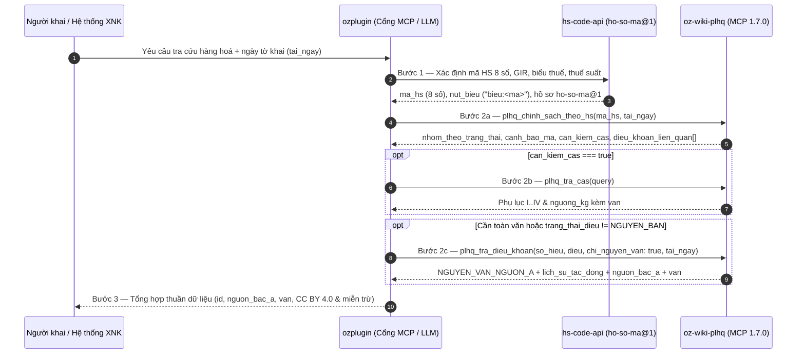

# Mẫu tích hợp Hệ sinh thái XNK OZ (`1.7.0` · `lop-kho@1`)

> **Tài liệu chuẩn cắm ghép cho `hs-code-api/scripts/sync-plhq.mjs`, `ozplugin` và các repo XNK mới** (C/O & xuất xứ FTA, tờ khai hải quan, logistics/`oz-freight-api`, `erp-xnk`, `ozsource`). Tài liệu này cụ thể hoá hợp đồng kỹ thuật của lược đồ `1.7.0` (sau Wave 30 `#770`, Wave 31 `#772`, Wave 32 `#771`) — đảm bảo **0% trùng lặp** miền sự thật và **0% trộn lớp tin cậy**.

---

## 1. Kiểm tra toàn vẹn & phiên bản (`dist/manifest.json`)

Mỗi lần dựng (`npm run dung`) và phát hành GitHub Release `dist-YYYY-MM-DD`, kho xuất **8 tệp dữ liệu JSON** kèm **`dist/manifest.json`** và **`SHA256SUMS`**.

- **URL phát hành ổn định (khuyến nghị cho downstream):**
  - Bất biến theo bản chụp: `https://github.com/ozvietnam/oz-wiki-plhq/releases/download/dist-YYYY-MM-DD/<tep>`
  - Mới nhất đã phát hành: `https://github.com/ozvietnam/oz-wiki-plhq/releases/latest/download/<tep>`
  - Nhánh `main` (chỉ dùng cho đồng bộ tức thời): `https://raw.githubusercontent.com/ozvietnam/oz-wiki-plhq/main/dist/<tep>`
- **Quy tắc bắt buộc khi nạp bản chụp:**
  1. Tải `dist/manifest.json` trước, kiểm tra `chuan_lop_du_lieu === "lop-kho@1"` và **major** của `luoc_do_phien_ban` (`"1.7.0"` → chấp nhận `1.x`, **từ chối ngay** nếu khác major `1`).
  2. Đối chiếu `sha256` (64 hex thường) và `bytes` của từng tệp trong `manifest.tep[ten]` trước khi nạp vào kho tiêu thụ.
  3. **Đồng bộ gia tăng (incremental sync):** so `manifest.tep[ten].sha256` với bản chụp cục bộ đã lưu; tệp nào trùng `sha256` thì bỏ qua không tải/không lập chỉ mục lại.

```js
// Mẫu Node.js (>=20, 0 dependency) cho scripts/sync-plhq.mjs & downstream
import { createHash } from 'node:crypto';
import { readFileSync } from 'node:fs';

export function kiemTraManifest(manifest, prevManifest = null) {
  const [major] = String(manifest?.luoc_do_phien_ban || '').split('.');
  if (major !== '1') {
    throw new Error(`Lệch major lược đồ oz-wiki-plhq: ${manifest?.luoc_do_phien_ban} (yêu cầu 1.x)`);
  }
  if (manifest?.chuan_lop_du_lieu !== 'lop-kho@1') {
    throw new Error(`Chuẩn lớp dữ liệu không khớp: ${manifest?.chuan_lop_du_lieu}`);
  }
  const canTai = [];
  for (const [ten, meta] of Object.entries(manifest.tep || {})) {
    const cu = prevManifest?.tep?.[ten];
    if (!cu || cu.sha256 !== meta.sha256 || cu.bytes !== meta.bytes) {
      canTai.push({ ten, ...meta });
    }
  }
  return canTai;
}

export function xacThucTepTaiVe(buf, meta) {
  if (buf.length !== meta.bytes) {
    throw new Error(`Sai kích thước bytes: thực tế ${buf.length} !== manifest ${meta.bytes}`);
  }
  const sha = createHash('sha256').update(buf).digest('hex');
  if (sha !== meta.sha256) {
    throw new Error(`Sai SHA-256: thực tế ${sha} !== manifest ${meta.sha256}`);
  }
  return JSON.parse(buf.toString('utf8'));
}
```

---

## 2. Tuân thủ phân lớp kho `lop-kho@1`

Chuẩn `lop-kho@1` (định nghĩa trong [`tools/lib/van-tay.mjs`](../tools/lib/van-tay.mjs) và khai báo tại `dist/manifest.json`) gồm **5 lớp đóng băng** (`LOP_DU_LIEU`): `LUAT`, `RUT_TU_LUAT`, `BO_TRO`, `TIEN_LE`, `KY_THUAT`.

| Tệp trong `dist/` | `lop_du_lieu` gốc | `truong_lan` (tách lớp trong tệp) | Quy tắc tiêu thụ tại downstream (`hs-code-api`, C/O, ERP…) |
|---|---|---|---|
| `registry.json` | `LUAT` | — | Nạp nguyên vẹn danh sách `van_ban[]`, giữ `tinh_trang`, `quan_he`, `quan_he_nguoc`, `xac_minh`. |
| `hs-index.json` | `LUAT` | — | Phụ lục mã HS trích nguyên văn từ VBQPPL (`van_ban[].dong[]`). |
| `hs-index-theo-ma.json` | `LUAT` | • `ma`: `LUAT`<br/>• `canh_bao_ma`: `KY_THUAT`<br/>• `anh_xa_ahtn_cu`: `BO_TRO`<br/>• `tien_le_tb_tchq`: `TIEN_LE` | **Bắt buộc tách thư mục/bảng:** chỉ `ma` đi vào luồng sự thật `LUAT`; `tien_le_tb_tchq` phải nạp vào luồng `TIEN_LE` (bậc C, tham khảo); `anh_xa_ahtn_cu` chỉ dùng gợi ý đối chiếu (`BO_TRO`); `canh_bao_ma` là cờ chặn kỹ thuật (`KY_THUAT`). |
| `dieu-khoan.json` | `LUAT` | • `nguyen_van_nguon_a`: `LUAT`<br/>• `tom_tat_nhap`: `BO_TRO` | **Tuyệt đối không gộp chung:** chỉ `nguyen_van_nguon_a` được trích làm căn cứ pháp lý; `tom_tat_nhap` (`da_soat: false`) chỉ dùng định vị điều luật (`BO_TRO`). |
| `cas-index.json` | `LUAT` | — | Danh mục hoá chất `theo_cas` & `khong_co_cas` từ bảng phụ lục bậc A (vd `24/2026/NĐ-CP`). |
| `wiki-index.json` | `BO_TRO` | — | Chỉ mục trang wiki tổng hợp (không thay thế VBQPPL gốc). |
| `wiki-chunks.json` | `BO_TRO` | — | Đoạn wiki kèm `van_ban_lien_quan[]` và `canh_bao_hieu_luc`. |
| `chinh-sach-mo-ta.json` | `BO_TRO` | — | Gợi ý Tầng 2 theo mô tả (`do_tin: "VUA_SUY_RA"`) + 25 viết tắt PLHQ; không dùng áp mã HS. |

> **Ranh giới bất biến (`0%` trùng lặp):** `oz-wiki-plhq` không xuất `chu-giai-hs.json` hay `chu-giai-chuong.json` ra `dist/`. Phân loại HS theo 6 quy tắc GIR, chú giải WCO/AHTN SEN, thuế suất và kho tiền lệ thuộc `hs-code-api`.

---

## 3. Định danh chuẩn (`id`) & vân tay nội dung (`van`) cho `ho-so-ma@1`

Downstream dùng chung các định dạng ID tất định từ [`tools/lib/van-tay.mjs`](../tools/lib/van-tay.mjs) và hàm khoá `khoa(so_hieu)` từ [`tools/lib/registry.mjs`](../tools/lib/registry.mjs) để gắn thẳng vào nút của `ho-so-ma@1`:

| Thực thể | Tệp nguồn | Định dạng `id` / `nut_bieu` chuẩn | Đầu vào tính `van` (64-char SHA-256 hex) |
|---|---|---|---|
| **Văn bản VBQPPL** | `registry.json` (`van_ban[]`) | `id: "vb:<slug>"`<br/>Khoá đối chiếu số hiệu: `khoa(so_hieu)` *(hoa, `Đ→D`, bỏ khoảng trắng)* + nạp `so_hieu_khac[]` | `{ so_hieu, ten, tinh_trang, hieu_luc_tu, het_hieu_luc_tu, quan_he }` |
| **Điều khoản nguồn A** | `dieu-khoan.json` (`nguyen_van_nguon_a[].dieu_khoan[]`) | `id: "vb:<slug>:d:<dieu>[:k:<khoan>][:dm:<diem>]"` | `tinhVanTay(c.noi_dung)` *(chuẩn hoá `\r\n`→`\n` + trim)* |
| **Dòng phụ lục HS** | `hs-index.json` (`dong[]`) | `nut_bieu: "bieu:<ma_hs>"` *(khi có `ma_hs` 4/6/8 số)* | `{ so_hieu, ma_hs, loai_tac_dong, mo_ta, dieu_kien, phu_luc, nhom, dan_chieu }` |
| **Cạnh mã HS ↔ VB** | `hs-index-theo-ma.json` (`ma[khoa_hs][]`) | `nut_bieu: "bieu:<khoa_hs>"` *(không lặp trường `ma_hs`)* | `{ ma_hs, so_hieu, loai_tac_dong, muc_rui_ro, dieu_kien, nhom, phu_luc }` |
| **Hóa chất CAS** | `cas-index.json` (`theo_cas[cas][]`, `khong_co_cas[]`) | `id: "cas:<ma_cas>:<slug>:<idx>"` *(hoặc `cas:khong-ma:<slug>:<idx>`)*; kèm `nut_bieu` nếu có `ma_hs` | `{ cas, ten_hoa_chat, cong_thuc, ma_hs, phu_luc, muc, nguong_kg, so_hieu }` |

**Quy tắc làm mới cache / `ho-so-ma@1` theo `van`:**
- Mỗi nút/hồ sơ ở downstream lưu cặp `(id, van)` (hoặc `(nut_bieu, so_hieu, van)`).
- Khi đồng bộ bản `dist/` mới, chỉ các mã HS / điều khoản có `van` đổi (hoặc `trang_thai_dieu` đổi) mới phải dựng lại nút trong `ho-so-ma@1` — không cần quét/dựng lại toàn biểu thuế `11.871` dòng.

---

## 4. Tiêu thụ tín hiệu kiểm chứng

Downstream không chỉ đọc `tinh_trang` văn bản mà phải xử lý **4 tín hiệu kiểm chứng** đã gắn sẵn:

1. **Đồ thị sửa đổi cấp Điều (`trang_thai_dieu` + `lich_su_tac_dong[]`):**
   - Mỗi điều khoản trong `nguyen_van_nguon_a` mang `trang_thai_dieu` ∈ `{ NGUYEN_BAN, DA_SUA_DOI, DA_BAI_BO, DA_BO_SUNG, TAM_NGUNG }` (biên dịch từ `data/sua-doi-dieu/*.json`) và mảng `lich_su_tac_dong[]` (có `tu_ngay`, `loai_tac_dong`, `so_hieu_nguon`, `dieu_nguon`, `tom_tat`).
   - Khi lọc theo `tai_ngay` qua MCP/thư viện `tra-cuu-plhq.mjs`, hệ thống tự tính `trang_thai_dieu` tại mốc ngày đó và trả thêm `canh_bao_sua_doi` + `dieu_khoan_sua_doi_lien_quan[]` để lần sang văn bản sửa đổi mới hơn.
2. **Cờ chặn đối chiếu (`xac_minh.chan`):**
   - Các mã chặn (`CHAN_HIEU_LUC`): `THIEU_PDF_A`, `THIEU_DIEU_THI_HANH_A`, `THIEU_BAI_TUONG_MINH`, `SO_HIEU_LECH`, `CHO_CONG_BO_A`.
   - Khi gặp `xac_minh.chan.ma === "SO_HIEU_LECH"` (ví dụ `45/2024/TT-BCT` tại mã `26140010` trong `hs-code-api#1987` thực chất là `45/2023/TT-BCT`), downstream đánh dấu cảnh báo lệch số hiệu tại bản ghi dẫn chiếu và không coi số hiệu lệch là căn cứ hiệu lực.
3. **Nhóm mã ngoài biểu thuế (`canh_bao_ma` + `anh_xa_ahtn_cu`):**
   - Nếu khóa HS tra ra nằm trong `canh_bao_ma` (hiện có `136` nhóm mã không có trong biểu thuế đối chiếu), **dừng kết luận diện áp**. Có thể đọc gợi ý đối chiếu `anh_xa_ahtn_cu.mapping[ma_cu]` (`BO_TRO`) để dẫn hướng kiểm tra văn bản gốc và `hs-code-api`, tuyệt đối không tự áp mã thay thế.
4. **Phiên bản AHTN (`phien_ban_ahtn`):**
   - Mọi bảng `danh_muc_hs` (`43/43` danh mục hiện hành) và từng cạnh trong `hs-index-theo-ma.json` đều mang `phien_ban_ahtn` ∈ `{ AHTN_2017, AHTN_2022, AHTN_2028 }`.
   - Downstream dùng trường này để phân biệt cạnh trích theo kỳ AHTN cũ với biểu thuế hiện hành (đặc biệt khi chuyển tiếp sang **HS 2028**).

---

## 5. Giao thức 3 bước `hs-code-api` (`ho-so-ma@1`) ↔ `oz-wiki-plhq` (`1.7.0`) ↔ `ozplugin`

Quy trình này được công bố chính thức tại MCP resource `plhq://huong-dan/quy-trinh-agent` và xác nhận cờ năng lực qua `plhq://meta/luoc-do` (`tinh_nang_ozplugin.giao_thuc_he_sinh_thai`):



**Checklist bắt buộc ở Bước 3 (`ozplugin` / LLM):**
- Chỉ tổng hợp trên dữ liệu trả về từ Bước 1 & Bước 2 (**0% suy diễn** điều luật ngoài kho; nếu `ngoai_pham_vi: true` thì thực hiện fallback lớp 2 theo `goi_y_du_phong`).
- Phân nhóm chính sách theo đúng `nhom_theo_trang_thai`: `dang_ap_dung` (nghĩa vụ hiện hành), `cat_giam` (`CAT_GIAM_KIEM_TRA` — danh mục được bỏ kiểm tra), `het_hieu_luc_hoac_sap_co_hieu_luc` (không áp làm nghĩa vụ hiện hành).
- Chỉ trích nguyên văn từ `NGUYEN_VAN_NGUON_A`, đính kèm `id` (`vb:...:d:...` / `bieu:...` / `cas:...`), `nguon_bac_a` và vân tay `van`; kèm chuỗi ghi nguồn **CC BY 4.0** và miễn trừ pháp lý:
  > *Nguồn: oz-wiki-plhq — https://github.com/ozvietnam/oz-wiki-plhq (CC BY 4.0, bản `phien_ban`). Tham khảo, không phải tư vấn pháp lý. Xem văn bản gốc nguồn bậc A trước khi áp dụng.*

---

## Xem thêm

- [Tích hợp gói dữ liệu `dist/` (`docs/tich-hop.md`)](tich-hop.md)
- [Lược đồ sổ đăng ký & lịch sử `1.0.0 → 1.7.0` (`docs/luoc-do-so-dang-ky.md`)](luoc-do-so-dang-ky.md)
- [Cổng MCP & CLI tra cứu (`docs/mcp-server.md`)](mcp-server.md)
- [Sơ đồ kiến trúc & ranh giới hệ thống (`docs/SO-DO-HE-THONG.md`)](SO-DO-HE-THONG.md)
- [Tầm nhìn & trạng thái thực thi Wave 30–33 (`docs/TAM-NHIN-VA-KE-HOACH-HE-SINH-THAI.md`)](TAM-NHIN-VA-KE-HOACH-HE-SINH-THAI.md)
